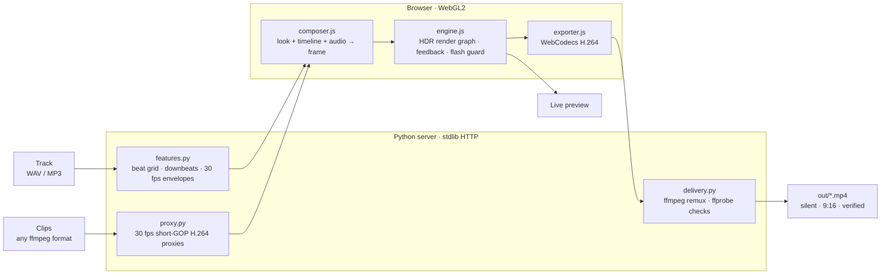

<div align="center">

# ✦ Canvas Forge

**Beat-locked, audio-reactive Spotify Canvas loops, designed live on the GPU.**

[](#-whats-new-in-v4)
[](https://www.python.org/)
[](#-how-it-works)
[](#-spotify-canvas-delivery)
[](LICENSE)

Drop in a few clips and your track. Canvas Forge finds the beat grid, suggests the loop, and lets you shape a look in real time while the song plays. Then it exports a silent, seamless 9:16 MP4 and checks it against Spotify's Canvas spec.

[Quickstart](#-quickstart) · [Making a canvas](#-making-a-canvas) · [Looks & effects](#-looks-effects--transitions) · [Delivery](#-spotify-canvas-delivery) · [How it works](#-how-it-works) · [CLI](#-classic-studio--headless-cli)

</div>

---

## ✦ What's new in v4

v4 replaces render-to-see with a real-time **WebGL2 studio**. Every slider, look and cut is live while the music plays, and the export goes through the same render path, so the file is the frame you saw.

| | |
| :--- | :--- |
| **Live GPU preview** | An HDR render graph (half-float targets, dual-Kawase bloom, anamorphic streaks, god rays, feedback buffers) renders the finished canvas while the song plays. |
| **A real beat grid** | Tempo to 0.02 BPM from a kick-weighted search, beat phase, downbeats, and six 30 fps envelopes: kick, snare, hats, bass, energy, brightness. |
| **Modulate anything** | Any continuous parameter can follow an audio band, a beat pulse, a bar ramp, a 1-bar LFO or a per-beat random value. The slider shows the live value. |
| **45 effects, 36 looks** | Liquid glass, holographic film, liquid chrome, feedback tunnels, slit scan, datamosh smear, beat shockwaves, star glints, tilt shift, dither palettes, CMYK halftone, glyph matrix, pixel sort, film stocks, VHS, CRT and more. 18 studio looks (one hero effect, one supporting effect, a designed grade) plus the classic studio's 18 presets rebuilt as fuller **Classic stacks**. |
| **🎲 Roll everything** | `D` (or the **Roll** button) re-rolls the look, a 4–6 layer effect stack, every parameter and modulation, the grade, the camera, the cut rhythm, the transition pool, clip direction, speed, FX intensity and per-clip looks in one go. `Shift`+`D` undoes it; the ▾ menu picks what a roll may change. |
| **Per-clip looks** | Run one look over the whole edit, or give every clip its own stack: **Evolve** (each clip mutates the main look), **Look per clip** (a different curated look per clip) or **Custom** (pick or roll a stack per clip). Per-clip stacks run on each clip *before* the transition, so cuts blend between two differently styled clips. |
| **Variations** | `M` mutates the current look into six live variations; `R` rolls a random look; **Save as look** keeps yours. |
| **Seamless by construction** | Loops are whole bars, the seam is just another beat-centred cut, and everything that moves completes a whole number of cycles per loop. |
| **Beat-snapped timeline** | Cut rhythms, cut lines you drag along the beat grid, per-segment clip and transition overrides, 16 GPU transitions centred on the beat. |
| **Verified export** | Hardware H.264 through WebCodecs, remuxed by ffmpeg without a second encode, then checked with ffprobe plus a seam-smoothness and flash-rate report. |

The original CPU studio still lives at **`/classic`**, and the NumPy/OpenCV engine still powers the headless CLI.

---

## ⚡ Quickstart

You need **ffmpeg**, **Python 3.10+** and a browser with **WebGL2**. The studio is developed and tested in Chrome.

```bash
# macOS
brew install ffmpeg

# Debian / Ubuntu
sudo apt update && sudo apt install -y ffmpeg
```

```bash
git clone https://github.com/J-Reed700/canvas.git
cd canvas
./run.sh
```

`./run.sh` checks for ffmpeg, creates `.venv`, installs `numpy` and `opencv-python-headless`, and opens the studio at **http://127.0.0.1:8765**. Prefer other entry points? `make studio`, or `pip install -e . && canvasforge`.

**Media in.** On startup the studio picks up videos and `.wav` / `.mp3` tracks from `~/Downloads`. You can also drag files onto the window or add a path from the media panel. Uploads are stored in `out/uploads/`.

**Canvases out.** Exports land in `out/`, named after the look, tempo, length and size, for example `out/canvas-hyperspace-145bpm-6.6s-1080x1920-20261023-181502.mp4`.

---

## 🎛 Making a canvas

1. **Add clips and a track.** **+ Add clips or tracks** opens a file picker (or drop files anywhere). Click clips to put them in the edit and drag to reorder; **All**, **Solo**, **Reverse** and **Shuffle** rework the sequence in one click. Each clip gets a 30 fps playback proxy built in the background so seeking is instant and frame-exact.
2. **Pick the moment.** The track panel shows the detected tempo and suggests loops (**Drop**, **Peak 2**, **Peak 3**, **Intro**) snapped to downbeats. Choose 1, 2, 4 or 8 bars, or drag the window across the song overview. If the tempo is an octave off, use **½×** / **2×** or type the exact BPM.
3. **Pick a look — or roll one.** The gallery thumbnails render live on your own footage. Press `D` (**🎲 Roll**) to randomize everything at once, `M` for variations of the current look or `R` for a random look.
4. **Shape it.** In **Layers**, **Master** holds the **FX intensity** (0–150 %: below 100 % fades every layer toward the clean footage, above it the audio modulation hits harder) and the **Per clip** mode. **+ Add effect**, **🎲 Random**, **⇅ Shuffle** and **Clear** work on the stack; each layer can be reordered, bypassed and tuned. The dot button at the end of any slider routes it to kick, snare, hats, bass, energy, brightness, beat, bar, LFO or random. **Camera** handles zoom, drift, shake, sway and clip speed; **Finish** handles the grade, texture and cinema bars. In **Custom** per-clip mode, pick a clip in the strip (or click the look tag on a clip) to edit its own stack, and click any look in the gallery to apply it to that clip. **★ Save as look** stores the result.
5. **Cut it.** In **Edit**, choose a cut rhythm (on hits, ½ beat, every beat, ½ bar, bar, 2 bars, 3-3-2 swing, build-up, varied, one or two per clip), the transition pool (presets **All**, **Smooth**, **Kinetic**, **Glitch**, **Hard cuts**; double-click a transition to use only that one), transition length and order, and clip direction (forward, reverse, alternate, ping-pong, random). On the timeline, drag cut lines along the beat grid, or double-click a segment to change its clip or transition.
6. **Audition it.** **Loop** plays exactly the slice that drives the canvas, sample-accurately. **Listener** keeps the song playing while the canvas loops, which is what fans see. `H` toggles the Spotify player overlay and `S` the safe zones.
7. **Export.** Press `E`, pick a size, and the studio renders every frame exactly, encodes, remuxes and verifies. The result shows a checklist and a link to reveal it in Finder. With a track loaded it also saves a `-audio.mp4` companion by default, for previewing with sound.

### Keyboard shortcuts

| Key | Action | Key | Action |
| :--- | :--- | :--- | :--- |
| `Space` | Play / pause | `E` | Export |
| `←` `→` | Previous / next look | `[` `]` | Previous / next loop suggestion |
| `M` | Variations | `1`–`4` | Loop length 1 / 2 / 4 / 8 bars |
| `D` | 🎲 Roll everything | `Shift` `D` | Undo the last roll |
| `R` | Random look | `L` | Loop ↔ Listener audition |
| `H` | Spotify player overlay | `S` | Safe zones |
| `?` | Help | `Esc` | Close panels |

---

## 🎨 Looks, effects & transitions

### 36 looks

**Studio looks** — restraint: one hero effect, one supporting effect and a designed grade.

| Look | Layers | Vibe |
| :--- | :--- | :--- |
| **Liquid Chrome** | glass · chrome · bloom | Refracting glass over polished metal |
| **Neon Kaleidoscope** | kaleido · trails · bloom | Six-fold symmetry smearing into light |
| **Hyperspace** | trails · chroma · bloom | Infinite feedback tunnel that lunges on every kick |
| **1-Bit Signal** | dither · glitch | Ink dither with data tears on the snare |
| **Acid Rave** | ripple · dither | Cyber dither palette with shockwaves on the beat |
| **Super 8 Memory** | leak · bloom | Warm gate weave, halation and drifting light leaks |
| **VHS Afterhours** | lens · vhs | Tape bleed, fisheye and a rolling tracking band |
| **Thermal Vision** | gradient · edges · bloom | Heat-map palette with glowing contours |
| **Halftone Riot** | posterize · halftone | CMYK print screens and silkscreen bands |
| **Datamosh Dream** | liquid · echo · glitch | Liquid currents with prismatic motion echoes |
| **Golden Rays** | rays | Sunlight pouring through the frame |
| **Pixel Sort Acid** | pixelsort · gradient · chroma | Highlights melting into sorted streaks |
| **Glyph Terminal** | ascii · bloom · crt | The picture rendered as glowing type |
| **Iridescent Pulse** | ripple · holo · bloom | Holographic film rippling outward on the beat |
| **Anamorphic Night** | streaks · chroma | Teal-orange grade, cyan lens streaks, cinema bars |
| **Mirror World** | mirror · glass · hue | Quad symmetry through soft glass |
| **Clone Wall** | tile · zoomblur | A sliding video wall that punches on the kick |
| **Clean Cut** | bloom | Just the footage, graded and cut on the beat |

**Classic stacks** — the classic studio's 18 presets rebuilt on the GPU effects, with fuller stacks (the classic *zoom pulse*, *beat shake*, *grade*, *vignette*, *grain*, *halation* and *letterbox* now live in Camera and Finish).

| Look | Layers | Vibe |
| :--- | :--- | :--- |
| **Hypnotic Tunnel** | tunnel · echo · chroma · bloom | Tunnel, prism echoes, chroma kicks & neon bloom |
| **Acid Dither 2026** | dither · edges · crt | Bayer dither, cyber contours & CRT scanlines |
| **Analog CRT Melt** | liquid · chroma · crt · bloom | Liquid warp, chroma split, phosphor glow & grain |
| **Kaleido Rave** | mirror · hue · chroma · bloom | Quad mirror, hue orbit, chroma & bloom |
| **Cyber Glitch** | glitch · edges · chroma · bloom | Block glitch, neon contours, RGB split & beat shake |
| **Liquid Acid** | liquid · echo · solarize · bloom | Fluid warp, prism trails & solarized highlights |
| **Dark Cinema** | filmstock · bloom · streaks | Teal & orange, soft bloom, beat shake & heavy vignette |
| **VHS Retro Rewind** | lens · vhs · crt | Tape tracking, chroma bleed, scanlines & grain |
| **Neon Tokyo 2026** | echo · edges · filmstock · bloom | Cyberpunk grade, neon contours, prism trails & bloom |
| **Solar Flare** | solarize · filmstock · streaks · pulse | Anamorphic flares, solarize, golden hour & warm kick pulses |
| **Matrix Data Stream** | ascii · glitch · chroma · bloom | Matrix glyphs, glitch tears, chroma & bloom |
| **Prism Velocity** | zoomblur · echo · chroma · bloom | Kick zoom blur, prism echoes, chroma & beat shake |
| **Thermal Infrared** | ripple · gradient · bloom | FLIR heat map, bass shockwaves, grain & halation |
| **Duotone Acid Punk** | gradient · dither · edges · pulse | Acid duotone, contours, dither & warm kick pulses |
| **35mm Noir** | filmstock · leak · bloom | Sepia noir, light leaks, cinema bars & grain |
| **Kaleido Vortex** | kaleido · vortex · hue · bloom | Hex kaleidoscope, kick vortex, hue orbit & bloom |
| **Sub-Bass Quake** | ripple · chroma · bassrim | Bass shockwaves, bass rim, chroma & heavy shake |
| **Cosmic Hyperdrive** | tunnel · echo · glint · bloom | Star tunnel, prism echoes, star glints & bloom |

### 45 GPU effects

| Category | Effects |
| :--- | :--- |
| **Space** | Kaleidoscope · Mirror · Infinite Tunnel · Clone Grid · Fisheye · Ribbon Split · Little Planet |
| **Warp** | Liquid Flow · Liquid Glass · Shockwave · Vortex · Zoom Blur · Gravity Melt |
| **Time** | Feedback Trails · Chroma Echo · Slit Scan · Datamosh Smear |
| **Light** | Bloom · Anamorphic Flare · God Rays · Spectral Aberration · Light Leak · Star Glint · Tilt Shift · Double Vision · Warm Pulse · Beat Shutter · Bass Rim |
| **Stylize** | 1-Bit Dither · Halftone · Pixel Sort · Glyph Matrix · Data Glitch · VHS Tape · CRT Monitor · Neon Contours · Mosaic · Frost Mist |
| **Color** | Gradient Map · Holographic · Liquid Chrome · Hue Orbit · Posterize · Solarize · Film Stock (bleach bypass, cyberpunk, golden hour, sepia noir, cross process, teal & orange) |

Together with Camera and Finish these cover all 52 of the classic studio's shaders. **Beat Shutter** only ever dims, never below half brightness and at most once per beat, to stay photosafe.

Every look also runs a **Camera** stage (zoom, drift, shake, sway, clip speed) and a **Finish** stage: exposure, halation, temperature and tint, filmic tonemap, contrast, saturation, split toning, fade, vignette, grain, cinema bars and deband dithering.

### 16 beat-centred transitions

Dissolve · Luma · Zoom · Whip · Whip X · Glitch · Mosh · Ripple · Iris · Pixel · Swirl · Prism · Flare · Slices · Kaleido · Morph, plus a hard **Cut**. Each transition is centred on its beat, so the cut lands on the hit rather than after it.

---

## ✅ Spotify Canvas delivery

Spotify's [Canvas guidelines](https://support.spotify.com/us/artists/article/fix-spotify-canvas-upload-error/) ask for a **3–8 second, 9:16** MP4 (or JPG) that is **720–1080 px tall**. Spotify plays your song itself, so a canvas should carry no audio.

Every export is checked with `ffprobe` and shows a checklist:

- **Length** 3–8 s
- **Aspect** 9:16 and **height** at least 720 px
- **Codec** H.264, yuv420p, constant 30 fps
- **Silent**: no audio stream at all
- **Fast-start** (`moov` before `mdat`)
- **Loop seam**: the frame step across the wrap compared with the loop's own 95th-percentile step
- **Flashes**: a WCAG-style count of luminance flashes per second, over the full frame and each quadrant

| Size | Use it when |
| :--- | :--- |
| **1080×1920** | The usual master size for vertical video |
| **720×1280** | You want a smaller file |
| **608×1080** | You want to match the "720–1080 px tall" wording literally |

Spotify's height range and the common 1080×1920 master disagree, so the checklist adds a note to anything taller than 1080 px. If an upload is ever rejected for size, re-export at 608×1080.

### Photosensitivity

The finish stage runs a GPU **flash guard** that limits how far mean brightness can move from one frame to the next, and the export reports flashes per second against the three-per-second guideline.

---

## 🧠 How it works



- **One frame source.** `compose(ctx, t)` turns the look, the timeline and the audio features at time *t* into a single engine frame. The live preview, the gallery thumbnails and the exporter all call it, which is why preview equals export.
- **Beat analysis runs once, on the server.** A short-time FFT at a 30 fps hop builds band envelopes and a kick-weighted onset curve. A global search over 70–180 BPM, refined to 0.02 BPM, finds the tempo; kick energy settles the beat phase and picks the downbeat. A number from 80–169 in the filename (`track_145bpm.wav`) overrides detection.
- **Proxies make export deterministic.** Each clip is converted once into constant-30 fps H.264 with an 8-frame GOP, so the exporter can seek any frame exactly and render at full speed instead of in real time.
- **Seamless loops.** Loop lengths are whole bars, the seam is treated as one more cut centred on the downbeat, noise fields cross-fade over exactly one loop, and feedback effects are pre-rolled for a full loop before recording starts.
- **Export.** Frames are encoded in the browser with WebCodecs (Annex B H.264) and posted to the server, where ffmpeg rewrites the timestamps and remuxes without re-encoding. Browsers without WebCodecs H.264 fall back to streaming raw frames to ffmpeg.
- **Local only.** The server binds to `127.0.0.1` and rejects requests with a foreign `Host` header or cross-site `Origin`, so other web pages can't drive it.

### Project layout

```text
canvas/
├── run.sh · run · Makefile     # one-command launcher and shortcuts
├── pyproject.toml              # package metadata and the `canvasforge` entry point
├── canvasforge/
│   ├── server.py               # local HTTP server: media, features, proxies, export API
│   ├── features.py             # beat grid, downbeats, loop suggestions, 30 fps envelopes
│   ├── proxy.py                # background 30 fps short-GOP playback proxies
│   ├── delivery.py             # Annex B remux, raw-frame fallback, Spotify spec checks
│   ├── studio/                 # the v4 GPU studio
│   │   ├── index.html          #   layout and styles
│   │   ├── app.js              #   UI, state, timeline, export sheet
│   │   ├── engine.js           #   WebGL2 render graph
│   │   ├── shaders.js          #   GLSL: camera, finish, bloom, flash guard, transitions
│   │   ├── modules.js          #   the 45 effects and their parameters
│   │   ├── looks.js            #   the 36 looks, mutation, random looks and chaos rolls
│   │   ├── composer.js         #   compose() and the video pool
│   │   ├── timeline.js         #   beat-grid cut planning and sampling
│   │   ├── audio.js            #   Web Audio transport and modulation sampler
│   │   └── exporter.js         #   WebCodecs export and seam / flash stats
│   ├── ui.html                 # classic CPU studio (/classic)
│   ├── audio.py · source.py · recipe.py · effects.py · compositor.py · encoder.py
│   └── cli.py                  # headless CLI on the classic engine
└── tests/
    ├── test_pipeline.py        # classic engine
    ├── test_studio.py          # beat grid, loop lengths, remux, verifier, proxies
    └── studio.test.mjs         # timeline, modulation, looks, flash counter (node --test)
```

### Development

```bash
make test                       # Python suite; also runs the JS suite when Node is installed
node --test tests/              # just the studio's JS tests
```

The JS tests import the studio modules directly, so they need Node 18 or newer and no `npm install`.

---

## 💻 Classic studio & headless CLI

The v3 CPU studio is still served at **http://127.0.0.1:8765/classic**. It renders with NumPy and OpenCV and has its own set of 18 presets, 52 shaders, 14 transitions and 4 loop topologies. The same engine drives the headless CLI, which is handy for batch jobs and scripts.

<details>
<summary><b>CLI usage and flag reference</b></summary>

#### Basic Commands

```bash
# Launch interactive Studio UI (default when no videos are passed)
./run.sh

# List all 18 presets and 52 shader modules
./run.sh --list

# Inspect a generated recipe without rendering
./run.sh clip1.mp4 clip2.mp4 --preset hypnotic --dry-run
```

#### Production Rendering Examples

##### 1. Audio-Reactive Multi-Clip Montage with Kinetic Transitions
```bash
./run.sh clip1.mp4 clip2.mp4 clip3.mp4 clip4.mp4 \
  --audio track.wav \
  --preset hypnotic \
  --cut-beats 2.0 \
  --cut-mode syncopated \
  --transitions datamosh whip zoom_punch prism_split \
  --transition-mode random \
  --trans-frames 12 \
  --loop-mode morph \
  --out out/kinetic-canvas.mp4
```

##### 2. Per-Video Filter Evolution Across Clips
```bash
./run.sh intro.mp4 drop.mp4 solo.mp4 outro.mp4 \
  --audio master.mp3 \
  --filter-mode evolve \
  --cut-mode build_up \
  --clip-direction alternate \
  --duration 8.0 \
  --out out/evolved-canvas.mp4
```

##### 3. Preset-Per-Video Cycle with Rebound Loop Topology
```bash
./run.sh synth.mp4 guitar.mp4 drums.mp4 \
  --audio live.wav \
  --filter-mode preset_cycle \
  --cut-mode fit_all_2x \
  --loop-mode rebound \
  --speed 1.25 \
  --out out/rebound-canvas.mp4
```

##### 4. Batch Render Multiple Independent Videos Separately
```bash
# Renders clip1.mp4, clip2.mp4, and clip3.mp4 into individual Spotify Canvas files
./run.sh clip1.mp4 clip2.mp4 clip3.mp4 \
  --separate \
  --preset crt_melt \
  --duration 6.0
```

#### Full CLI Flag Reference

| Flag | Default | Description |
| :--- | :--- | :--- |
| `videos ...` | *(interactive)* | Input MP4 video paths. If omitted, launches the Studio UI |
| `-o, --out` | `out/sample-canvas.mp4` | Destination filepath for exported `.mp4` master |
| `--studio` | `False` | Force launch interactive browser Studio |
| `--port` | `8765` | Studio local HTTP server port |
| `--no-browser` | `False` | Prevents automatically opening browser on studio launch |
| `--audio` | `None` | Path to `.wav` or `.mp3` master track for FFT beat synchronization |
| `--preset` | `None` | Curated style preset (see [Table 1](#table-1-all-18-curated-presets---preset)) |
| `--seed` | *(random)* | Integer recipe seed for 100% deterministic reproducibility |
| `--bpm` | *(auto)* | Explicit BPM override (auto-detected when `--audio` is supplied) |
| `--duration` | `8.0` | Spotify Canvas loop length in seconds (`3.0` to `24.0`) |
| `--loop-mode` | `crossfade` | Loop topology: `crossfade`, `rebound`, `morph`, `hard` |
| `--cut-beats` | `4.0` | Beat interval between cuts (e.g. `0.5`, `1.0`, `2.0`, `4.0`) |
| `--cut-mode` | `steady` | Rhythm mode: `steady`, `fit_all`, `fit_all_2x`, `build_up`, `syncopated`, `transient`, `chaos` |
| `--ensure-all-clips` | `True` | Guarantees every input clip transitions at least once |
| `--no-ensure-all` | `False` | Disables guarantee to use raw unadjusted beat cuts |
| `--transition` | `None` | Lock a single transition (e.g. `datamosh`, `luma`, `flash`) |
| `--transitions` | `None` | Active multi-transition pool (e.g. `--transitions luma whip glitch`) |
| `--transition-mode` | `cycle` | Pool sequence: `random` (shuffle per cut), `cycle`, `single` |
| `--trans-frames` | `12` | Transition blend duration in frames (`4` to `30`) |
| `--clip-direction` | `forward` | Playback direction: `forward`, `reverse`, `alternate`, `pingpong`, `chaos` |
| `--filter-mode` | `global` | Filter mode: `global`, `evolve`, `preset_cycle`, `per_clip` |
| `--intensity` | `1.0` | Global shader effect intensity multiplier |
| `--speed` | `1.0` | Source video playback speed multiplier (`0.5` to `2.0`) |
| `--effects` | `6` | Maximum active shaders in random recipe stack |
| `--separate` | `False` | Render each video input separately instead of a multi-clip montage |
| `--list` | `False` | Print all available presets and shader modules to stdout |
| `--dry-run` | `False` | Print the compiled render plan and recipe without rendering frames |

</details>

<details>
<summary><b>Classic engine reference: presets, transitions, loop topologies and shaders</b></summary>

#### Table 1: All 18 Curated Presets (`--preset`)

| Preset ID | Studio Name | Visual Signature | Default Cut | Default Transition |
| :--- | :--- | :--- | :---: | :---: |
| `hypnotic` | **Hypnotic Tunnel** | Beat-synced zoom kicks, prismatic echoes, neon bloom & seamless multi-clip cuts | `4 Beats` | `luma` |
| `acid_dither` | **Acid Dither 2026** | Ordered 4×4 Bayer matrix dithering, glowing cyber-sigil contours, CRT halation & scanlines | `4 Beats` | `glitch` |
| `crt_melt` | **Analog CRT Melt** | Sub-bass liquid UV wave displacement, warm red-orange CRT phosphor halation & 35mm grain | `4 Beats` | `datamosh` |
| `kaleido` | **Kaleido Rave** | 4-way symmetrical geometry flips on the bar with acid hue drift & strobe impacts | `4 Beats` | `whip` |
| `cyber_glitch` | **Cyber Glitch** | Aggressive slice displacement, RGB split, cyber contours & rapid 2-beat datamosh cuts | `4 Beats` | `datamosh` |
| `liquid_dream` | **Liquid Acid** | Fluid UV wave warp, solarize highlights, prism trails & warm analog halation | `8 Beats` | `luma` |
| `dark_cinema` | **Dark Cinema** | Moody anamorphic contrast grade, subtle beat shake, film halation glow & heavy vignette | `8 Beats` | `luma` |
| `anamorphic_flare` | **Blade Runner Flare** | Horizontal cyan anamorphic lens streaks, neon cyberpunk split-tone & prism trails | `4 Beats` | `prism_split` |
| `thermal_rave` | **Thermal Predator** | Infrared FLIR heat-vision color map, shockwave bass ripples & cyber contours | `4 Beats` | `glitch` |
| `vhs_99` | **1999 VHS Camcorder** | Skate fisheye barrel lens, VHS tape tracking noise, chroma bleed & CRT halation | `4 Beats` | `whip` |
| `super8_burn` | **Super-8 Film Burn** | Kodak golden hour grade, organic 16mm amber light-leak burns & pendulum sway | `8 Beats` | `burn_luma` |
| `pixel_melt` | **Pixel Sort Acid** | Luminance pixel-sorting streaks, acid duotone gradient map & 4×4 Bayer dither | `4 Beats` | `pixelate` |
| `hex_portal` | **Hex Kaleido Portal** | 6-fold radial kaleidoscope symmetry, 4-point star filter glints & neon bloom | `4 Beats` | `kaleido_twist` |
| `fractal_void` | **Infinite Fractal Void** | Recursive picture-in-picture tunnel, vortex twist, bleach bypass & bass rim-punch | `4 Beats` | `zoom_punch` |
| `pop_halftone` | **Warhol Halftone Pop** | CMYK halftone dot screen, silkscreen posterize pop colors & ribbon slices | `4 Beats` | `shutter_slice` |
| `matrix_sigil` | **Matrix Cyber Terminal** | LED glyph dot-matrix synthesizer, glowing Sobel wireframes & datamosh smear | `4 Beats` | `datamosh` |
| `velvet_mist` | **Dreamy Pro-Mist Halo** | Ethereal highlight mist diffusion, miniature tilt-shift bokeh & star glints | `8 Beats` | `iris_wipe` |
| `clone_overdrive` | **Clone Wall Overdrive** | Multi-tile video wall, radial zoom motion blur, double vision & neon rim-light | `4 Beats` | `whip_horiz` |

---

#### Table 2: All 14 Cut Transitions (`--transition` / `--transitions`)

| Transition Key | Studio Label | Style Pool | Visual Mechanism |
| :--- | :--- | :--- | :--- |
| `datamosh` | Mosh | Glitch & Mosh | Dense Farneback optical flow motion smear (I-frame drop illusion) + emerging blocky macroblocks |
| `luma` | Luma | Smooth Cinema | Luminance threshold burn wipe — incoming clip blooms through brightest highlights of outgoing clip |
| `burn_luma` | Film Burn | Smooth Cinema | Organic 16mm analog film-burn glow concentrated on mid-luminance edge regions while cross-dissolving |
| `flash` *(dissolve)* | S-Dissolve | Smooth Cinema | Buttery-smooth S-curve cross-dissolve with gentle warm exposure cushion and zero harsh white flash |
| `whip` | Whip Vert | Kinetic Whip | High-speed vertical whip pan blur (`cv2.GaussianBlur` along vertical motion vector) |
| `whip_horiz` | Whip Horiz | Kinetic Whip | High-speed horizontal whip pan blur along horizontal motion vector |
| `glitch` | Glitch | Glitch & Mosh | Multi-band horizontal scanline slice displacement and jitter across cuts with stable seeded noise |
| `zoom_punch` | Zoom Punch | Kinetic Whip | Outgoing clip punches forward into extreme zoom while incoming clip pulls back from hyper-scale |
| `spin_vortex` | Spin Vortex | Kinetic Whip | Centered rotational vortex spin (`cv2.warpAffine` 180° rotation) with dynamic perspective scaling |
| `prism_split` | Prism Split | Cinema / Glitch | Asymmetric chromatic split where Blue, Green, and Red channels transition with distinct phase offsets |
| `pixelate` | Pixelate | Glitch & Mosh | Coarsens the image into chunky pixel blocks peaking at the cut midpoint and resolving into clip B |
| `iris_wipe` | Iris Wipe | Smooth Cinema | Radial circular iris expansion outward from the center reveals incoming footage |
| `shutter_slice` | Shutter Slice | Kinetic Whip | 10 horizontal shutter bands staggered across the frame sliding in progressively |
| `kaleido_twist` | Kaleido Twist | Glitch & Mosh | 4-way symmetrical kaleidoscope mirror twist with central zoom pulse at transition peak |

---

#### Table 3: All 4 Loop Topologies (`--loop-mode`)

| Mode Key | Studio Name | Technical Mechanism | Best Use Case |
| :--- | :--- | :--- | :--- |
| `crossfade` | **Seamless Crossfade** | Linear S-curve crossfade over the final 10 frames back into Frame 0 | Standard multi-clip montages where natural blending creates an undetectable seam |
| `rebound` | **Ping-Pong Rebound** | First half plays forward; second half plays in reverse with mirrored symmetry | Ambient textures, liquid warps, and single-clip loops guaranteeing 100% mathematically zero-seam loops |
| `morph` | **Transition Morph** | Morphs the loop seam using the active transition blend mode (e.g., datamosh or luma) | High-energy kinetic cuts where the loop seam acts as a rhythmic drop transition |
| `hard` | **Hard Cut** | Straight cut from the final frame back to Frame 0 with zero cross-blending | Exact modular loop bars and drum-machine beat sequences that land squarely on Downbeat 1 |

---

#### Table 4: All 52 Shaders & Color Filters (`canvasforge/effects.py`)

##### Motion (8 Modules)
| Effect Key | Studio Name | Description |
| :--- | :--- | :--- |
| `zoom_pulse` | **Zoom Pulse** | Breathing camera zoom + smooth kick swell on beat or sub-bass hit. |
| `beat_bounce` | **Beat Shake** | Smooth camera shake / drift on the beat using zoomed crop window. |
| `liquid_warp` | **Liquid Warp** | Slit-scan UV sine-wave displacement field driven by sub-bass & beat phase. |
| `pendulum_sway` | **Pendulum Sway** | Beat-locked Dutch-angle rotation swaying rhythmically with corner zoom compensation. |
| `shockwave_ripple` | **Shockwave Ripple** | Radial concentric sine-wave displacement ring expanding outward on beat/sub-bass hits. |
| `slit_scan` | **Slit Scan** | Horizontal and vertical time-wave slit-scan displacement modulated by beat pulse. |
| `gravity_droop` | **Gravity Droop** | Vertical stretch/melt warp driven by sub-bass pulse. |
| `vortex_twirl` | **Vortex Twirl** | Smooth swirl twist around frame center decaying exponentially with radius. |

##### Geometry (6 Modules)
| Effect Key | Studio Name | Description |
| :--- | :--- | :--- |
| `mirror_quad` | **Kaleido Mirror** | Symmetrical mirror / 4-way kaleidoscope geometry. |
| `kaleido_hex` | **Hex Kaleido** | 6-way / 8-way radial polar kaleidoscope symmetry folded around frame center. |
| `grid_clone` | **Grid Clone** | Beat-reactive tiled video wall with alternating tile tint shifts. |
| `fractal_tunnel` | **Fractal Tunnel** | Recursive picture-in-picture zoom tunnel with glowing screen borders. |
| `ribbon_split` | **Ribbon Split** | Alternating horizontal ribbon bands that slide in opposing directions on beat hits. |
| `polar_tunnel` | **Polar Tunnel** | Polar coordinate warp tunnel projection blended with base frame. |

##### Optics (10 Modules)
| Effect Key | Studio Name | Description |
| :--- | :--- | :--- |
| `prism_echo` | **Prism Echo** | Additive zoomed ghost layer that expands outward gently on each beat. |
| `neon_bloom` | **Neon Bloom** | Extract bright highlights, Gaussian-blur them, and screen-blend for glowing halation. |
| `crt_halation` | **CRT Halation** | Analog film & CRT phosphor halation: warm red-orange aura bleed around bright highlights. |
| `chroma_pulse` | **Chroma Split** | Beat-synced radial / horizontal RGB split (chromatic aberration). |
| `anamorphic_flare` | **Anamorphic Flare** | Horizontal cinema anamorphic blue/cyan lens flares on bright highlights. |
| `star_glint` | **Star Glint** | 4-point optical cross star filter diffraction spikes on highlights. |
| `tilt_shift` | **Tilt Shift** | Miniature cinematic depth-of-field bokeh with sharp focal plane. |
| `fisheye_lens` | **Fisheye Lens** | Barrel distortion wide-angle lens pulsing on the beat. |
| `radial_zoom_blur` | **Zoom Blur** | Multi-tap explosive radial zoom blur triggered by transients/kicks. |
| `double_vision` | **Double Vision** | Twin ghost image chromatic separation that expands on beat hits. |

##### Digital (8 Modules)
| Effect Key | Studio Name | Description |
| :--- | :--- | :--- |
| `bayer_dither` | **Bayer Dither** | Acid graphics ordered 4×4 Bayer matrix dithering & bit-depth quantization. |
| `edge_neon` | **Cyber Contours** | Cyber-sigil glowing Sobel contour wireframes pulsed by high-hat air & kicks. |
| `glitch` | **Slice Glitch** | Digital slice displacement on beat transients (photosensitive-safe, no strobe inversions). |
| `pixel_sort` | **Pixel Sort** | Luminance-thresholded vertical pixel smear. |
| `ascii_matrix` | **Cyber Matrix** | Cyber dot-matrix / LED grid synthesizer. |
| `rgb_mosaic` | **RGB Mosaic** | Beat-reactive pixelation block mosaic with sub-pixel RGB stripes. |
| `vhs_tracking` | **VHS Tracking** | Authentic VHS tape look with chroma horizontal bleed and rolling tracking jitter. |
| `datamosh_smear` | **Datamosh Smear** | Blocky 16×16 macroblock displacement on beat transients. |

##### Color (10 Modules)
| Effect Key | Studio Name | Description |
| :--- | :--- | :--- |
| `solarize_pulse` | **Acid Solarize** | Smooth psychedelic pastel tint shift on bright highlights (never inverts luminance). |
| `hue_cycle` | **Hue Drift** | True HSV hue rotation over the loop. |
| `color_grade` | **Cinema Grade** | High-contrast cinema grade with steady, smooth tone curve. |
| `duotone_acid` | **Duotone Acid** | High-impact 2-color gradient map based on luminance. |
| `thermal_infrared` | **Thermal FLIR** | FLIR false-color thermal vision filter with beat-synced contrast swell. |
| `bleach_bypass` | **Bleach Bypass** | High-contrast gritty silver-retention cinema bleach-bypass grade. |
| `cyberpunk_grade` | **Cyberpunk Grade** | Neon split-toning: deep violet shadows and electric cyan highlights. |
| `golden_hour` | **Golden Hour** | Warm Kodak Portra analog grade: lush amber highlights, velvet shadows. |
| `sepia_noir` | **Sepia Noir** | High-contrast silver-gelatin monochrome with beat-reactive contrast swell. |
| `posterize_pop` | **Posterize Pop** | Bold pop-art color quantization with crisp saturation boost. |

##### Texture (7 Modules)
| Effect Key | Studio Name | Description |
| :--- | :--- | :--- |
| `vignette` | **Vignette** | Smooth radial vignette that breathes with the beat. |
| `scanlines` | **CRT Scanlines** | CRT scanline texture with subtle vertical roll. |
| `grain` | **35mm Grain** | Fast tiled organic 35mm film grain. |
| `letterbox` | **Cinema Bars** | Beat-breathing cinema letterbox bars. |
| `film_burn` | **Film Burn** | Organic 16mm warm amber/ruby light leak along frame edges. |
| `halftone_dots` | **Halftone Dots** | Pop-art halftone dot screen pattern. |
| `frost_mist` | **Frost Mist** | Ethereal cinematic pro-mist diffusion filter with lifted pastel blacks. |

##### Impact (3 Modules)
| Effect Key | Studio Name | Description |
| :--- | :--- | :--- |
| `flash` | **Warm Pulse** | Photosensitive-safe warm exposure swell on downbeats. |
| `strobe_shutter` | **Strobe Shutter** | Rhythm gate effect that adds a crisp border/exposure pulse (photosensitive safe, max luma delta < 12). |
| `bass_vignette_punch` | **Bass Rim Punch** | Electric neon rim-light border glow that flares on sub-bass kicks. |

</details>

---

## ❓ FAQ

**Why do exports have no audio?**
Spotify plays your song alongside the canvas, so the canvas file itself has to be silent. Canvas Forge only uses audio for analysis and auditioning. To watch the loop with the music, open the `-audio.mp4` companion saved next to the export; don't upload that one.

**The tempo is wrong.**
Usually it's off by an octave. Click **½×** or **2×** in the track panel, or type the exact BPM; **auto** goes back to the detected value. Putting the tempo in the filename (`track_145bpm.wav`) also works.

**Which browser should I use?**
Any browser with WebGL2 should run the studio; it is developed and tested in Chrome. Exports use the browser's WebCodecs H.264 encoder when it has one and fall back to sending raw frames to ffmpeg otherwise.

**Where did my disk space go?**
Playback proxies live in `out/.proxies/`. They are safe to delete; the studio rebuilds them when needed.

**Can I make longer loops for Reels, TikTok or Shorts?**
The GPU studio is built around Spotify's 3–8 second window. The classic CLI renders up to 24 seconds with `--duration`.

---

## 📄 License

Released under the [MIT License](LICENSE).
