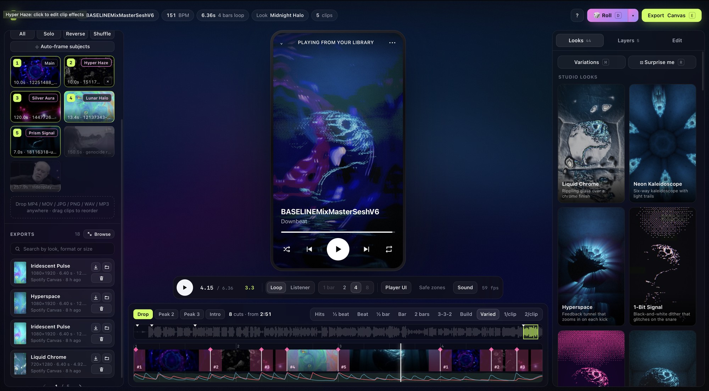
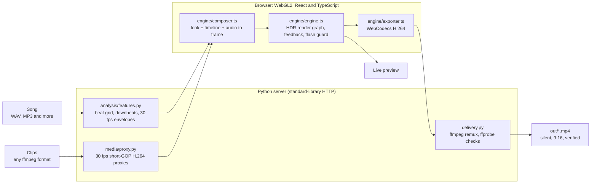

# Downbeat

Downbeat makes Spotify Canvas loops from your video clips, photos or cover art, cut to the beat of your song. You pick the song and the clips, choose a look, and export a silent 9:16 MP4 that has already been checked against Spotify's Canvas requirements.

It runs on your own computer. A small Python server reads the song and handles files, and the editor (the studio) runs in Chrome and renders on your graphics card. The same project also exports Apple Music motion art, a 16:9 YouTube visualizer with the song, square social clips, 3000 × 3000 cover art and artist banners.




Version 4.0. MIT license. Runs on macOS, Linux and Windows.

## Contents

- [What it does](#what-it-does)
- [Requirements](#requirements)
- [Installation](#installation): [macOS](#macos), [Windows](#windows-10-and-11), [Linux](#linux)
- [Make your first Canvas](#make-your-first-canvas)
- [Upload it to Spotify](#upload-it-to-spotify)
- [Using the studio](#using-the-studio)
- [Looks, effects and transitions](#looks-effects-and-transitions)
- [Exporting](#exporting)
- [Troubleshooting](#troubleshooting)
- [FAQ](#faq)
- [Privacy](#privacy)
- [How it works](#how-it-works)
- [Development](#development)
- [Command-line renderer](#command-line-renderer)

The full guide to every panel and control is in [docs/STUDIO_GUIDE.md](docs/STUDIO_GUIDE.md).

## What it does

- Finds the song's tempo (to 0.02 BPM) and its downbeats, and suggests where the loop should start, with labels such as Drop, Peak and Intro.
- Cuts your clips on the beat grid. Loops are always a whole number of bars, so the end of the loop meets the start in time with the music.
- Styles the video with one of 44 looks, or with your own stack built from 49 effects. Cuts can use any of 16 transitions, each centered on its beat.
- Moves any slider with the music. A slider can follow one of eight bands of the song (kick, snare, hats, bass, energy, brightness, vocals, presence), a clock synced to the tempo, two LFOs, a 16-step sequencer, an envelope you draw, or one of two macro knobs.
- Animates still images and cover art with a fake-depth parallax effect. One look adds a spectrum visualizer on top.
- Frames each clip on its subject. You can drag the preview to reframe, or pick a different moment of a clip for one segment.
- Makes random versions to start from. Roll (`D`) changes the look, a 4 to 6 layer effect stack, the edit and the per-clip effects in one go. Variations (`M`) shows six altered copies of the current look.
- Pulls a five-color palette from your cover art and applies it to a look.
- Previews the video on a screen of the export's shape while the song plays: a phone with Spotify's player drawn over it for a Canvas, or a landscape, tablet or square screen for the other formats.
- Exports through the same renderer as the preview, so the file matches what you saw frame for frame. Each export is checked with ffprobe, and video loops also get a loop-seam check and a flash count.

Downbeat does not upload anything for you, and it has no accounts. You upload the file yourself in Spotify for Artists.

## Requirements

| What | Needed | Notes |
| :--- | :--- | :--- |
| Computer | A Mac, a Linux PC, or a Windows 10 or 11 PC | Tested on macOS 26 (Apple Silicon). [Linux](#linux) has a table of the distributions that were tested. Windows has had less testing than macOS and Linux |
| Browser | Chrome or Edge, with hardware acceleration turned on | The studio needs WebGL2. It's developed and tested in Chrome. Safari and Firefox haven't been tested |
| Graphics | A GPU that Chrome can use for WebGL2 | Open `chrome://gpu` and look for "WebGL2: Hardware accelerated" |
| ffmpeg | 6.1 or newer, with libx264 | `./run.sh` (or `run.ps1` on Windows) installs it. Tested with 6.1 through 9.0. The older ffmpeg in Ubuntu 22.04 (4.4) and Debian 12 (5.1) can't write exports correctly |
| Python | 3.10 or newer | `./run.sh` installs it |
| Node.js | 20.19+ or 22.12+ | Only used to build the studio. `./run.sh` installs it |
| Disk | About 250 MB for the project's packages | A new Mac needs about 1 GB more for Homebrew, ffmpeg, Python and Node. Playback copies of your clips go in `out/.proxies/` |

## Installation

If you already have git, Python 3.10+, ffmpeg 6.1+ and Node.js 20.19+:

```bash
git clone https://github.com/J-Reed700/downbeat.git
cd downbeat
./run.sh
```

The studio opens at http://127.0.0.1:8765. The first run takes 1 to 5 minutes, depending on what it has to install and build. After that it starts in about a second.

On a computer that doesn't have those tools yet, follow the steps for your system below. `./run.sh` installs whatever is missing, and it asks before installing anything outside the project folder.

### What gets installed

| Tool | What it's for | Installed by `./run.sh` |
| :--- | :--- | :--- |
| Chrome or Edge | Runs the studio | No, install it yourself |
| git | Downloading the code and updates | No, or use [the ZIP](#no-git-download-the-zip) |
| ffmpeg and ffprobe | Playback copies of your clips, writing and checking exports | Yes |
| Python 3.10+ | The local server, tempo detection, auto-framing | Yes |
| Node.js and npm | Building the studio (React, Vite, TypeScript) | Yes |
| Python packages: `numpy`, `opencv-python-headless` | Audio analysis, framing, the command-line renderer | Yes, into `.venv/` in the project folder |
| npm packages from `package-lock.json` | The studio's code and build tools | Yes, into `node_modules/` in the project folder |

### macOS

This works on Apple Silicon and Intel Macs running a macOS version that Homebrew supports (the three most recent releases).

1. Open Terminal: press `⌘ Space`, type Terminal and press Return. Paste each command below and press Return after it.

2. Install Homebrew, the usual macOS package manager. It also installs Apple's Command Line Tools, which include git.

   ```bash
   /bin/bash -c "$(curl -fsSL https://raw.githubusercontent.com/Homebrew/install/HEAD/install.sh)"
   ```

   It asks for your Mac login password. Nothing appears on screen while you type it. Press Return when it asks you to continue. This takes 5 to 15 minutes.

3. On Apple Silicon Macs, add Homebrew to your PATH. The installer prints these lines under "Next steps":

   ```bash
   echo >> ~/.zprofile
   echo 'eval "$(/opt/homebrew/bin/brew shellenv)"' >> ~/.zprofile
   eval "$(/opt/homebrew/bin/brew shellenv)"
   ```

   Intel Macs can skip this step. Run `brew --version` to check that it worked.

4. Install the tools. `./run.sh` would offer to do this for you, but doing it now gets the wait out of the way:

   ```bash
   brew install git python@3.12 ffmpeg node
   ```

5. Download Downbeat into your home folder and start it:

   ```bash
   cd ~
   git clone https://github.com/J-Reed700/downbeat.git
   cd downbeat
   ./run.sh
   ```

6. If you don't have Google Chrome, install it from [google.com/chrome](https://www.google.com/chrome/). The studio opens in your default browser. If that's Safari, copy the address into Chrome.

To start it again later, open Terminal and run `cd ~/downbeat && ./run.sh`. Press `Ctrl + C` in Terminal to stop the server.

### Windows 10 and 11

There are two ways to run Downbeat on Windows. Both open the studio in your normal Chrome or Edge, so it still renders on your graphics card.

- From PowerShell, with `run.ps1`. This is the shorter setup.
- Inside WSL (Windows Subsystem for Linux), which runs the server in a copy of Ubuntu.

Git Bash can't run `run.sh`. Use PowerShell or WSL instead.

#### With PowerShell

1. Open PowerShell: right-click Start and choose Terminal. Install git with winget, then close the window and open a new one so it finds git:

   ```powershell
   winget install --id Git.Git -e
   ```

2. Download Downbeat into your user folder and start it:

   ```powershell
   cd ~
   git clone https://github.com/J-Reed700/downbeat.git
   cd downbeat
   powershell -ExecutionPolicy Bypass -File run.ps1
   ```

   Windows doesn't run downloaded scripts by default. `-ExecutionPolicy Bypass` lets this one run without changing that setting.

   `run.ps1` asks to install ffmpeg, Python 3.12 and Node.js LTS with winget. Answer Y each time. If it then says a tool isn't on your PATH, open a new PowerShell window and run the last two commands again.

3. The studio opens in your default browser. Windows has no folder chooser here, so click Pick a folder and type the path to your videos, such as `C:\Users\<your-name>\Videos`. Finished exports go to your Downloads folder, and copies stay in the `out` folder inside `downbeat`.

To start it again later, open PowerShell and run `cd ~\downbeat; powershell -ExecutionPolicy Bypass -File run.ps1`. Press `Ctrl + C` to stop the server. `run.ps1` takes the same flags as `./run.sh`, such as `--setup`, `--yes` and `--port 8766`, and `make studio` runs it for you if you have make.

#### With WSL

WSL gives you a copy of Ubuntu, and the server runs there. The Linux side is the same as the tested Ubuntu setup.

1. Install WSL. Right-click Start, choose Terminal (Admin) or Windows PowerShell (Admin), and run:

   ```powershell
   wsl --install
   ```

   Restart when it asks. After the restart an Ubuntu window opens and asks you to pick a Linux username and password. You'll need that password whenever a command uses `sudo`.

2. Check which Ubuntu you have:

   ```bash
   lsb_release -d
   ```

   If it says 22.04, its ffmpeg is too old and exports will fail. Install a newer Ubuntu from PowerShell with `wsl --install -d Ubuntu-24.04`, then use that one for the next steps.

3. In the Ubuntu window, install git and curl, then download and start Downbeat:

   ```bash
   sudo apt update && sudo apt install -y git curl
   cd ~
   git clone https://github.com/J-Reed700/downbeat.git
   cd downbeat
   ./run.sh
   ```

   `./run.sh` asks to install ffmpeg and Python with `apt`, which needs your Linux password, and Node.js with nvm. Answer Y each time.

   Keep the project in your Linux home folder (`~`) as shown. Linux tools are much slower on files under `/mnt/c`.

4. WSL can't open a browser tab for you. Open Chrome or Edge on Windows and go to http://localhost:8765.

5. The studio opens on Pick a folder. Click it and type the path to your videos on the Windows side, such as `/mnt/c/Users/<your-windows-name>/Videos`. You can also drag clips, images and songs from File Explorer onto the studio. Finished exports go to your Windows Downloads folder. Copies also stay in `\\wsl$\Ubuntu\home\<your-linux-name>\downbeat\out` (`Ubuntu-24.04` instead of `Ubuntu` if you installed that one), which you can paste into File Explorer's address bar.

To list your Windows music too, open the Track menu, choose + Add a folder, and type a path such as `/mnt/c/Users/<your-windows-name>/Music`.

To start it again later, open Ubuntu from the Start menu, run `cd ~/downbeat && ./run.sh`, and go to http://localhost:8765.

### Linux

Install git and curl, and `./run.sh` handles the rest:

```bash
# Ubuntu, Debian, Mint, Pop!_OS
sudo apt update && sudo apt install -y git curl

# Fedora
sudo dnf install -y git curl

# Arch, Manjaro
sudo pacman -S --needed git curl

# openSUSE (opi codecs installs Packman's ffmpeg, which has the x264 encoder)
sudo zypper install git curl opi
opi codecs
```

```bash
cd ~
git clone https://github.com/J-Reed700/downbeat.git
cd downbeat
./run.sh
```

`./run.sh` installs ffmpeg and Python's venv module (`python3-venv` on Debian and Ubuntu) with your package manager. It installs Node.js LTS with [nvm](https://github.com/nvm-sh/nvm) into `~/.nvm`, without sudo, because distribution Node packages are often too old for Vite.

Results from fresh containers running `./run.sh --yes --setup`, then the Python tests and a server start:

| Distribution | Result | Python and ffmpeg it set up |
| :--- | :--- | :--- |
| Ubuntu 26.04 | Works | Python 3.14, ffmpeg 8.0 |
| Ubuntu 24.04 | Works. Also tested with a real export from Chrome | Python 3.12, ffmpeg 6.1 |
| Ubuntu 22.04 | Installs and runs, but exports fail because its ffmpeg is too old. Use 24.04 or newer | Python 3.10, ffmpeg 4.4 |
| Debian 13 | Works | Python 3.13, ffmpeg 7.1 |
| Debian 12 | Installs and runs, but exports come out with broken timing because its ffmpeg is too old. Use Debian 13 | Python 3.11, ffmpeg 5.1 |
| Fedora 44 | Works, after `./run.sh` switches to RPM Fusion's ffmpeg | Python 3.14, ffmpeg 8.1 |
| Arch | Works | Python 3.14, ffmpeg 9.0 |
| openSUSE Tumbleweed | Works, after installing ffmpeg from Packman (below) | Python 3.13, ffmpeg 9.0 |

On Fedora, the default `ffmpeg-free` package can't encode H.264 with x264, so `./run.sh` offers to enable [RPM Fusion](https://rpmfusion.org/) and switch to the full ffmpeg. openSUSE's own ffmpeg has the same gap, and `./run.sh` stops with a message if it finds it. `opi codecs`, shown above, installs ffmpeg from the [Packman](https://en.opensuse.org/Additional_package_repositories#Packman) repository instead. If your distribution's Python is older than 3.10, install a newer one first (for example with [pyenv](https://github.com/pyenv/pyenv)), then run `PYTHON=python3.12 ./run.sh`.

### No git? Download the ZIP

On the [GitHub page](https://github.com/J-Reed700/downbeat), click Code, then Download ZIP. Unzip it, then in a terminal:

```bash
cd ~/Downloads/downbeat-main
chmod +x run.sh
./run.sh
```

To update, download the ZIP again. Copy the `out/` folder across if you want to keep your exports and added songs.

### What `./run.sh` does

Each time you run it, `./run.sh` goes through these steps and skips any that are already done:

1. Looks for ffmpeg, Python 3.10+ and Node.js 20.19+. If one is missing, it asks before installing it. On macOS it uses [Homebrew](https://brew.sh), and offers to install Homebrew first if you don't have it. On Linux it uses `apt`, `dnf`, `pacman` or `zypper`, plus nvm for Node.js.
2. Creates `.venv/`, a Python environment private to this folder, and installs the Python packages into it. It reinstalls them when `pyproject.toml` changes.
3. Runs `npm ci` when `node_modules/` is missing or `package-lock.json` has changed.
4. Builds the studio into `downbeat/studio/dist/` when there's no build yet, or when a studio source file is newer than the last build.
5. Starts the server and opens http://127.0.0.1:8765 in your browser. If another copy of Downbeat is already running on that port, it replaces it. If something else is using the port, it tries the next one, up to 8779.

On Windows, `run.ps1` goes through the same steps and installs tools with winget.

Without a terminal (in a script or CI) and without `--yes`, it prints the install command it would have run and stops.

| Command | What it does |
| :--- | :--- |
| `./run.sh` | Sets up anything missing, then opens the studio |
| `./run.sh --setup` | Installs and builds, but doesn't start the studio |
| `./run.sh --yes` | Installs missing tools without asking. `DOWNBEAT_YES=1` does the same |
| `./run.sh --port 8766` | Uses a different port. Any flag `./run.sh` doesn't know goes to `python -m downbeat` |
| `./run.sh --no-browser` | Starts the server without opening a browser tab |
| `PYTHON=python3.12 ./run.sh` | Uses that Python to create `.venv/` |
| `./run` or `make studio` | Same as `./run.sh` |

### Setting it up by hand

If you'd rather not use `./run.sh`, install ffmpeg 6.1+ (with libx264), Python 3.10+ and Node.js 20.19+ yourself, then run:

```bash
python3 -m venv .venv
./.venv/bin/python -m pip install --upgrade pip
./.venv/bin/python -m pip install -e .
npm ci
npm run build
./.venv/bin/python -m downbeat --studio
```

### Checking the install

```bash
ffmpeg -version | head -n 1    # 6.1 or newer
python3 --version              # 3.10 or newer
node --version                 # v20.19 or newer (v22.18+ to run the JS tests)
./run.sh --setup               # ends with "Setup complete"
make test                      # runs the Python and studio test suites
```

Then open the studio, add a clip and press Space. The clip should play, and the FPS counter under the preview should read about 60. If the preview stays black, see [Troubleshooting](#troubleshooting).

### Updating

```bash
cd ~/downbeat
git pull
./run.sh
```

`./run.sh` works out what changed and only reinstalls or rebuilds that.

### Uninstalling

Everything Downbeat installs is inside its own folder: `.venv/`, `node_modules/`, `downbeat/studio/dist/`, and your exports and added songs in `out/`. Delete the folder to remove it:

```bash
rm -rf ~/downbeat
```

ffmpeg, Python and Node are shared tools, so removing them is up to you. On macOS that's `brew uninstall ffmpeg node python@3.12`. On Ubuntu it's `sudo apt remove ffmpeg`, and nvm's Node goes with `rm -rf ~/.nvm`.

## Make your first Canvas

This walk-through takes about ten minutes. You need a song file (WAV, MP3, FLAC, M4A, AAC, AIFF, OGG or Opus) and a few short video clips or a cover image.

1. Start Downbeat with `./run.sh`. The first time, the studio opens on a Pick a folder button. Click it and choose the folder your clips are in. Downbeat lists the videos and songs in that folder and its subfolders, puts up to five clips in the edit and picks the newest song. The song plays while it's being analyzed, and the loop moves to a suggested section when the analysis is done.

2. The studio has three columns: your song and clips on the left, the preview in the middle, and the Looks, Layers and Edit tabs on the right. To add files from somewhere else, drag them onto the window or click + Add files. Each clip in the edit gets a playback copy built in the background. Until that's done the clip shows a spinning ring. The other videos in the folder are dimmed with a dashed border. Hover over one and click + Add to put it in the edit.

3. Pick the song from the Track menu at the top of the left column if it isn't the one you want. Downbeat analyzes it and shows the tempo. If the tempo is half or double what it should be, click ½× or 2×, or click the number and type the right one.

4. Pick which part of the song loops. The chips above the timeline (Drop, Peak, Intro and so on) are suggested start points. You can also drag the highlighted box along the waveform.

5. Set the loop length with the 1, 2, 4 or 8 bar buttons, or keys `1` to `4`. A Spotify Canvas has to be 3 to 8 seconds long, and Downbeat counts four beats to a bar, so the lengths that fit depend on the tempo:

   | Tempo | 1 bar | 2 bars | 4 bars | 8 bars |
   | :--- | :--- | :--- | :--- | :--- |
   | 90 BPM | 2.7 s | 5.3 s | 10.7 s | 21.3 s |
   | 100 BPM | 2.4 s | 4.8 s | 9.6 s | 19.2 s |
   | 120 BPM | 2.0 s | 4.0 s | 8.0 s | 16.0 s |
   | 128 BPM | 1.9 s | 3.8 s | 7.5 s | 15.0 s |
   | 140 BPM | 1.7 s | 3.4 s | 6.9 s | 13.7 s |
   | 170 BPM | 1.4 s | 2.8 s | 5.6 s | 11.3 s |

   A note under the loop length tells you when a length won't pass as a Canvas.

6. Click clips in the Clips list to put them in the edit. Each one gets a number, and the timeline shows the same numbers (#1, #2 and so on) where that clip plays.

7. Pick a look in the Looks tab. Press `D` to roll a random look and edit, and `Cmd+Z` (`Ctrl+Z` on Windows and Linux) to go back.

8. Press Space to play. Press `H` to show or hide the Spotify player on top of the preview. Press `S` to show the safe zones: the top 14% and bottom 33% that Spotify's controls cover, and the 9% on each side that tall phones crop. Safe zones are only shown on the phone screen. Keep faces and anything important out of those areas.

9. Press `E` to open the export sheet. Choose Spotify Canvas at 1080 × 1920 and click Render & verify. When it finishes, the sheet lists the checks it ran. The file downloads to your browser's Downloads folder, and a copy stays in the project's `out/` folder.

To go further, change the effect layers in the Layers tab and the cut rhythm and transitions in the Edit tab. [Using the studio](#using-the-studio) and [docs/STUDIO_GUIDE.md](docs/STUDIO_GUIDE.md) cover each control.

## Upload it to Spotify

According to [Spotify's help article](https://support.spotify.com/us/artists/article/adding-a-canvas/), you can add a Canvas if you're the first main artist on the track, or a main artist on both the track and the release, and you have Admin or Editor access in Spotify for Artists. You can add one to any track, including upcoming releases.

On the web:

1. Log in at [artists.spotify.com](https://artists.spotify.com).
2. Go to Music and select the track.
3. Click Add Canvas and choose the MP4 that Downbeat exported.

In the Spotify for Artists app, tap Music, select the track, and tap the edit icon next to Canvas.

Spotify's [Canvas guidelines](https://support.spotify.com/us/artists/article/canvas-guidelines/) ask for an MP4 or JPG, 3 to 8 seconds long, vertical 9:16, and 720 to 1080 px tall. Spotify plays your song with the Canvas, so Downbeat's Canvas file has no sound. The Spotify export meets these requirements with one exception: the default size is 1080 × 1920, which is taller than 1080 px. That's the size most people upload. If Spotify ever rejects it for its size, export again at 608 × 1080.

The guidelines also suggest avoiding rapid cuts and intense flashing, keeping important visuals away from the edges, and leaving out the song and artist name, which Spotify already shows. The [Canvas content policy](https://support.spotify.com/us/artists/article/canvas-content-policy/) says a Canvas can't sell anything or point people to websites, ticket sellers or social media accounts. Any text has to relate to the track. Mark a Canvas as explicit if it includes profanity, violence, drugs, sexual content or other sensitive topics.

### Apple Music motion art

You can't upload motion art to Apple Music yourself. Apple [takes it through your distributor](https://artists.apple.com/support/5544-create-motion-artwork), so check your distributor's requirements before you export. Downbeat makes both sizes that distributors list: 3:4 at 2048 × 2732 and 1:1 at 3840 × 3840. Both are silent H.264 MP4s, with the loop repeated until the video is at least 15 seconds long, up to 35. The 3:4 file is encoded at 50 Mbps. The 1:1 file is rendered at 2048 × 2048 and scaled up by ffmpeg (x264, CRF 18), because the browser's encoder can't produce video that large. Some distributors want both sizes, and some only take ProRes `.mov` files, which Downbeat doesn't make. ffmpeg can convert one:

```bash
ffmpeg -i canvas-apple.mp4 -c:v prores_ks -profile:v 3 -an canvas-apple.mov
```

## Using the studio

This section gives an overview. [docs/STUDIO_GUIDE.md](docs/STUDIO_GUIDE.md) covers each panel in detail.

### The screen

The left column holds the track, its tempo and beat grid, the level meters, your clips and your past exports. The middle shows the preview, the transport bar and the timeline. The bar along the top shows the track, tempo, loop length, look and clip count. On its right are Undo and Redo (the ↶ and ↷ arrows), the keyboard shortcuts button, Roll and Export. The arrow next to Roll chooses what a roll changes.

The right column has three tabs. Looks is the gallery of 44 looks. Layers holds the effect stack, the Camera and Finish settings, the color palette and the modulators. Edit sets the cut rhythm, transitions, clip direction, speed ramps and loop length.

### Adding clips, images and songs

Downbeat lists the videos and songs in the folders you pick, and the files you add.

- + Add a folder (in Clips and in the Track menu) lists a folder's videos and songs, including its subfolders, and leaves the files where they are. On a Mac it opens the system folder chooser. On Linux and Windows you type the folder's path. The folders are saved in `out/.library.json`, and ✕ next to a folder in the Track menu stops listing it.
- + Add files, or dragging files onto the window, copies them into Downbeat.

| Kind | Formats |
| :--- | :--- |
| Video | `.mp4 .mov .m4v .webm .mkv`, and anything else ffmpeg can read |
| Images | `.jpg .jpeg .png .webp .heic`, also `.bmp .tif .tiff .heif` |
| Songs | `.wav .mp3 .flac .m4a .aac .aif .aiff .ogg .opus` |

Added files are copied into `out/uploads/` and come back after a restart.

Each clip you put in the edit gets a playback copy in `out/.proxies/` (30 fps H.264 with a keyframe every 8 frames), so scrubbing is smooth and exports can seek to exact frames. 4K files take longer. Videos you haven't put in the edit get no copy, so a folder of 50 videos doesn't keep your computer busy. They're dimmed with a dashed border until you add them. Images are turned into short still clips.

From each folder, Clips lists the 50 newest videos and the Track menu lists every song of 250 KB or more (smaller files are usually alert sounds). Downbeat's own exports are left out, so a folder that holds them, such as Downloads, doesn't list them as clips.

### Tempo and the loop

The tempo comes from the song. A tempo in the filename, such as `track_145bpm.wav`, overrides the detected one. Use ½×, 2×, Tap (or `T`), or click the number and type a tempo. Auto puts the detected tempo back.

If cuts land a little early or late, shift the beat grid with the arrows next to it, 10 ms per click.

The Edit tab also takes longer loops for visualizers: any number of bars, a time such as 2:30, or Whole song.

### Looks, layers and modulation

A look is a stack of effect layers, plus a Camera stage (zoom, drift, shake, sway, clip speed) and a Finish stage (exposure, contrast, saturation, temperature, tint, split tone, fade, halation, vignette, grain, cinema bars).

Every enabled layer runs on every frame. To make a slider move with the music, click the dot at the end of the slider and choose what drives it: a band of the song, a tempo clock, LFO A or B, the step sequencer, your drawn envelope, or a macro. You edit the LFOs, envelope, steps and macros in the Modulators card on the Layers tab.

Each clip can use the main look, a variation of it, or its own stack.

### The edit

In the Edit tab, choose the cut rhythm, which transitions to use, the clip direction and speed ramps. On the timeline:

- Split a segment at the playhead (`B`), repeat its first half (`⌘D`), put another clip in from the playhead, or delete it (`Delete`) and let the segment before play on. The buttons above the timeline do the same on a touch screen.
- Drag a cut to move it along the beat grid, or to half or quarter beats with Snap (`N`). Hold `Shift` to put it anywhere.
- Drag the edge of a transition's pink band to set how long that one lasts.
- `Alt`-drag (Option on a Mac) a segment to use a different part of its clip.
- Double-click a segment, right-click it, press Enter, or long-press it on a touch screen to change just that one: where its cuts sit (on or off the beat), its transition and how long it lasts, and the in-point, the moment of the clip it starts on.

The studio picks each segment's in-point at random from the edit seed, within the clip's first 60 seconds, and a clip that comes back picks up where it left off. What you cut and set by hand is cleared when you change the clips, the rhythm or the loop, so set those first. The [studio guide](docs/STUDIO_GUIDE.md#cutting-blocks-by-hand) has the details.

### The preview

The preview shows the video on a screen of the export's shape. The Screen button in the transport bar (or `O`) switches between Phone 9:16 for a Spotify Canvas, Landscape 16:9 for a YouTube visualizer, Tablet 3:4 for Apple Music motion art, and Square 1:1 for social feeds, Apple's square art and cover art. The screen and the export format are one setting: picking a screen picks a format of that shape, and picking a format in the export sheet changes the screen. Look thumbnails take the same shape.

Drag on the preview to reframe the clip that's showing, scroll to zoom in (up to 3×), and double-click to reset that clip's framing. A single segment can have its own framing instead, set in its segment menu (double-click it on the timeline), including a push in, pull out or pan from one cut to the next. The [studio guide](docs/STUDIO_GUIDE.md#framing-one-segment) covers it.

Loop mode plays only the slice of the song under the Canvas, over and over. Listener mode lets the song keep playing while the Canvas loops, which is what someone listening on Spotify sees. `L` switches between them. In Listener mode, Off-sync starts the Canvas at a random point in the song, because Spotify doesn't line a Canvas up with the music.

### Keyboard shortcuts

| Key | Action | Key | Action |
| :--- | :--- | :--- | :--- |
| `Space` | Play or pause | `E` | Export |
| `Left` / `Right` | Previous or next look | `[` / `]` | Previous or next loop suggestion |
| `M` | Look variations | `1` to `4` | Loop length: 1, 2, 4 or 8 bars |
| `D` | Roll a new look and edit | `Shift+D` | Undo the last roll |
| `Cmd+Z` / `Shift+Cmd+Z` | Undo / redo, the same as the ↶ ↷ buttons (`Ctrl` on Windows and Linux, and `Ctrl+Y` also redoes) | `T` | Tap tempo |
| `R` | Random look | `L` | Switch between Loop and Listener mode |
| `H` | Show or hide the Spotify player overlay | `S` | Show or hide the safe zones (phone screen only) |
| `O` | Next screen: phone, landscape, tablet, square | `?` | Keyboard help |
| `B` | Split the segment at the playhead | `Cmd+D` | Repeat the segment's first half (`Ctrl+D` on Windows and Linux) |
| `Delete` | Delete the selected segment | `N` | Snap: beat, ½ beat, ¼ beat or off |
| `Esc` | Close the open panel, or deselect a segment | | |

## Looks, effects and transitions

### 44 looks

The 18 studio looks are short stacks: one main effect, sometimes a second, and a color grade.

| Look | Layers | Description |
| :--- | :--- | :--- |
| Liquid Chrome | glass, chrome, bloom | Rippling glass over a chrome finish |
| Neon Kaleidoscope | kaleido, trails, bloom | Six-way kaleidoscope with light trails |
| Hyperspace | trails, chroma, bloom | Feedback tunnel that zooms in on each kick |
| 1-Bit Signal | dither, glitch | Black-and-white dither that glitches on the snare |
| Acid Rave | ripple, dither | Colored dither with a ripple on every beat |
| Super 8 Memory | leak, bloom | Warm home-movie film with light leaks |
| VHS Afterhours | lens, vhs | Tape bleed, fisheye and a rolling tracking line |
| Thermal Vision | gradient, edges, bloom | Heat-camera colors with glowing edges |
| Halftone Riot | posterize, halftone | Posterized color printed as CMYK dots |
| Datamosh Dream | liquid, echo, glitch | Liquid warp with color-split motion echoes |
| Golden Rays | rays | Light rays streaming out of the bright areas |
| Pixel Sort Acid | pixelsort, gradient, chroma | Bright pixels dragged into long sorted streaks |
| Glyph Terminal | ascii, bloom, crt | The picture redrawn in glowing text characters |
| Iridescent Pulse | ripple, holo, bloom | Holographic sheen with a ripple on the beat |
| Anamorphic Night | streaks, chroma | Teal and orange grade, blue lens streaks, letterbox |
| Mirror World | mirror, glass, hue | Four-way mirror seen through soft glass |
| Clone Wall | tile, zoomblur | A sliding wall of copies that jumps on the kick |
| Clean Cut | bloom | Your footage, color graded and cut on the beat |

The 8 album art looks are made for a single image, such as cover art. They use the 2.5D Parallax effect for depth and a slow camera move.

| Look | Layers | Description |
| :--- | :--- | :--- |
| Living Cover Art | parallax, pulse, bloom | Parallax depth with a warm glow that swells with the vocals |
| Track Visualizer | parallax, visualizer, bloom | A spectrum ring over the cover art, pulsing on the kick |
| Cover Breathe | parallax, pulse, bloom | Slow parallax orbit with a soft pulse on the kick |
| Cover Sparkle | parallax, glint, leak | Parallax with star glints and a drifting light leak |
| Cover Dream | parallax, liquid, ghost, bloom | Parallax with a slow liquid melt and a warm glow |
| Cover on Tape | parallax, stutter, vhs, chroma | Parallax on VHS tape that freezes briefly on the kick |
| Cover Glitch | parallax, glitch, chroma, bloom | Parallax broken up by glitches on the snare |
| Cover Halo | parallax, rays, frost, filmstock | Light rays through the art with a frosted, golden grade |

The 18 classic looks are the presets from Downbeat's earlier CPU-based studio, rebuilt for the GPU. The Camera and Finish stages now do the zoom pulses, shake, grading, vignette, grain, halation and letterbox that the old presets did with separate shaders.

| Look | Layers | Description |
| :--- | :--- | :--- |
| Hypnotic Tunnel | tunnel, echo, chroma, bloom | Tunnel with prism echoes and a color split on the kick |
| Acid Dither 2026 | dither, edges, crt | Dither with neon outlines and CRT scanlines |
| Analog CRT Melt | liquid, chroma, crt, bloom | Liquid warp on an old CRT screen, with grain |
| Kaleido Rave | mirror, hue, chroma, bloom | Four-way mirror cycling through the color wheel |
| Cyber Glitch | glitch, edges, chroma, bloom | Block glitches and neon outlines, shaking on the beat |
| Liquid Acid | liquid, echo, solarize, bloom | Fluid warp with trails and solarized highlights |
| Dark Cinema | filmstock, bloom, streaks | Teal and orange with a heavy vignette and a shake on the beat |
| VHS Retro Rewind | lens, vhs, crt | Tape tracking errors with scanlines and grain |
| Neon Tokyo 2026 | echo, edges, filmstock, bloom | Cyberpunk colors with neon outlines and trails |
| Solar Flare | solarize, filmstock, streaks, pulse | Lens flares and solarized gold, with a warm pulse on the kick |
| Matrix Data Stream | ascii, glitch, chroma, bloom | Glowing text characters torn up by glitches |
| Prism Velocity | zoomblur, echo, chroma, bloom | Zoom blur on the kick with prism trails |
| Thermal Infrared | ripple, gradient, bloom | Infrared heat map with shockwaves on the bass |
| Duotone Acid Punk | gradient, dither, edges, pulse | Two-color acid palette with outlines and dither |
| 35mm Noir | filmstock, leak, bloom | Sepia film with light leaks and a letterbox |
| Kaleido Vortex | kaleido, vortex, hue, bloom | Six-sided kaleidoscope that twists on the kick |
| Sub-Bass Quake | ripple, chroma, bassrim | Shockwaves and a heavy shake on the bass |
| Cosmic Hyperdrive | tunnel, echo, glint, bloom | Star tunnel with prism trails and glints |

### 49 effects

| Group | Effects |
| :--- | :--- |
| Space (9) | 2.5D Parallax, Kaleidoscope, Mirror, Infinite Tunnel, Clone Grid, Fisheye, Ribbon Split, Little Planet, B-Roll Blend |
| Warp (6) | Liquid Flow, Liquid Glass, Shockwave, Vortex, Zoom Blur, Gravity Melt |
| Time (5) | Feedback Trails, Chroma Echo, Slit Scan, Datamosh Smear, Stutter |
| Light (11) | Bloom, Anamorphic Flare, God Rays, Spectral Aberration, Light Leak, Star Glint, Tilt Shift, Double Vision, Warm Pulse, Beat Shutter, Bass Rim |
| Stylize (11) | 1-Bit Dither, Halftone, Pixel Sort, Glyph Matrix, Data Glitch, VHS Tape, CRT Monitor, Neon Contours, Mosaic, Frost Mist, Audio Visualizer |
| Color (7) | Gradient Map, Holographic, Liquid Chrome, Hue Orbit, Posterize, Solarize, Film Stock |

Together with the Camera and Finish stages, these cover all 52 shaders of the earlier studio. Beat Shutter only dims the picture, never below half brightness and at most once per beat. What each effect's sliders do is in [the guide](docs/STUDIO_GUIDE.md#16-effects).

### 16 transitions

Light Dissolve, Luma Burn, Zoom Punch, Whip Pan, Whip Sideways, Block Glitch, Datamosh, Shock Ripple, Iris Bloom, Pixel Melt, Vortex, Prism Split, Light Leak, Shutter Slices, Kaleido Fold and Flow Morph, plus a hard cut. Each transition is centered on its beat, so the change lands on the hit.

## Exporting

Press `E`, or click Export, to open the export sheet. Pick a format and size, then click Render & verify. Picking a format also switches the preview to that shape. The studio renders every frame on the GPU, encodes it, sends it to the server, and checks the finished file. The result shows up in the Exports list on the left with a pass or fail badge.

### Formats

| Format | Size | What you get |
| :--- | :--- | :--- |
| Spotify Canvas, Master | 1080 × 1920 | The size most people upload. Silent, 3 to 8 s |
| Spotify Canvas, Lite | 720 × 1280 | A smaller file |
| Spotify Canvas, Spec-literal | 608 × 1080 | Exactly inside the 720 to 1080 px height Spotify lists. Use it if an upload is rejected |
| Apple Music, 3:4 | 2048 × 2732 | Portrait motion art. Silent, repeated to 15 to 35 s |
| Apple Music, 1:1 | 3840 × 3840 | Square motion art, rendered at 2048 and scaled up. Silent, repeated to 15 to 35 s |
| YouTube Visualizer | 1920 × 1080 | A 16:9 video with the song. Any length |
| Social Feed | 1080 × 1080 | A square loop, with the song if you want it. Any length |
| Album Cover Art | 3000 × 3000 | An sRGB JPEG cover, plus a square motion preview |

Spotify exports are encoded at 16 Mbps (9 Mbps for the smaller sizes). The other formats use 50 Mbps, or 20 Mbps for videos longer than a minute, which is about 150 MB a minute. The Apple 1:1 file is the exception: ffmpeg re-encodes it when it scales it up to 3840 × 3840. Every export streams to disk as it renders, so long videos aren't limited by memory.

### Options

| Option | What it does |
| :--- | :--- |
| Also save a copy with the audio slice | Writes a second MP4, ending in `-audio.mp4`, with the song playing from the loop start. Use it to watch or share the loop with sound. Don't upload it as your Canvas |
| Promo copy with the song | Writes a 15 or 30 second video of the loop repeated with the song underneath, for Reels, TikTok, Shorts or a Spotify Countdown Page |
| Save to my Downloads folder when it's done | On by default. Turn it off to keep files only in `out/` |

The GIF Loop and WebP Loop buttons in the export sheet, and the GIF teaser and WebP teaser buttons on an export in the exports library, make small looping previews, 540 px wide at 18 fps from the first 10 seconds, for places that don't play video.

### Stills, teasers and batch export

The Stills and teasers row makes stills from clip 1, framed on its subject: a 3000 × 3000 cover, a 2660 × 1140 Spotify artist header, a 2560 × 1440 YouTube banner and a 2480 × 520 SoundCloud header.

Batch has two buttons. Export 4 rolls renders four random rolls of the current edit, then puts your edit back. "This look on N songs" renders the current look and edit on the 12 newest songs in the same folder as the current one, each at its top loop suggestion, so every song on a release shares one style.

### What each export is checked for

After an export, ffprobe reads the file and the studio lists the results.

| Check | Passes when |
| :--- | :--- |
| Length | 3 to 8 s for a Canvas, 8 to 35 s for Apple Music. YouTube and Social can be any length |
| Aspect | 9:16 for a Canvas, 3:4 or 1:1 for Apple Music, 16:9 for YouTube, 1:1 for Social |
| Size | At least 720 px tall for a Canvas, and at least the format's size for the others |
| Codec | H.264, yuv420p |
| Frame rate | Constant 30 fps (23.976 to 30 fps for Apple Music) |
| Audio | None in Canvas and Apple Music files. Only promos and the `-audio` copy have sound |
| Fast start | The MP4's index (`moov`) comes before the video data (`mdat`), so playback can begin before the whole file arrives |
| Loop seam | The jump from the last frame back to the first is no bigger than 1.25 times the loop's normal frame-to-frame change |
| Flashes | No more than 3 flashes a second, over the whole frame or in any quarter of it |

Apple Music files also get a bitrate warning below 25 Mbps, since distributors often ask for 45 to 100 Mbps. A Canvas taller than 1080 px gets a note about Spotify's listed height range.

### Photosensitivity

The renderer always runs a flash guard on the GPU. It limits how much the average brightness can change from one frame to the next, for the preview and for exports. The export checks then count flashes per second against the common limit of three a second. The sheet also warns when the shortest cut is under 0.3 s or there are more than 2.5 cuts a second, since Spotify's guidelines advise against rapid cuts.

### Where files go

Exports are named `canvas-<look>-<bpm>bpm-<length>s-<width>x<height>-<timestamp>.mp4`, with the format added before the tempo for anything other than a Spotify Canvas (for example `canvas-clean-cut-apple-tall-128bpm-...`). They download to your browser's Downloads folder, and a copy stays in `out/`, along with any `-audio.mp4` and `-promo-<seconds>s.mp4` files. The Exports list on the left shows everything in `out/`, including renders from earlier sessions. Click an export, or Browse, to open the exports library, where you can play, search and delete them.

On a Mac, the Reveal in Finder button shows the file in Finder. On Linux and Windows, it shows the file's path in `out/` instead.

## Troubleshooting

| Problem | Fix |
| :--- | :--- |
| `permission denied: ./run.sh` | Run `chmod +x run.sh` once, or start it with `bash run.sh`. |
| `run.ps1 cannot be loaded because running scripts is disabled on this system` | Start it with `powershell -ExecutionPolicy Bypass -File run.ps1`, as in [the Windows steps](#with-powershell). |
| `command not found: brew` right after installing Homebrew | Run the three lines from [step 3 of the macOS setup](#macos), or open a new Terminal window. |
| `xcrun: error: invalid active developer path` | The Command Line Tools are missing, which can happen after a macOS update. Run `xcode-select --install`. |
| `ensurepip is not available` or `No module named venv` | Debian and Ubuntu package this separately. Run `sudo apt install python3-venv`, then `rm -rf .venv && ./run.sh`. `./run.sh` normally does this for you. |
| `Vite requires Node.js version 20.19+ or 22.12+` | Your Node is too old. Run `brew upgrade node` on macOS, `nvm install --lts` on Linux and WSL, or `winget upgrade OpenJS.NodeJS.LTS` on Windows. |
| `npm ERR! EACCES` | Don't use `sudo` with npm here. Run `rm -rf node_modules && ./run.sh`. |
| `pip` fails with `SSL: CERTIFICATE_VERIFY_FAILED` | If your Python came from python.org, run Install Certificates.command in `/Applications/Python 3.x/`, or use Homebrew's Python. |
| The browser didn't open | Go to http://127.0.0.1:8765 yourself. The terminal prints the exact address, which has a different port if 8765 was busy. |
| `Address already in use`, or an old copy is still running | Running `./run.sh` again replaces a Downbeat server that's already running. To use another port, run `./run.sh --port 8766`. |
| On WSL, http://localhost:8765 doesn't load in Windows | Update WSL with `wsl --update` in PowerShell. If that doesn't fix it, add `networkingMode=mirrored` under `[wsl2]` in `%UserProfile%\.wslconfig` and run `wsl --shutdown`. |
| On WSL, the Track menu has no songs | Add your Windows music folder with + Add a folder, for example `/mnt/c/Users/<your-windows-name>/Music`, or drag songs onto the studio. |
| Exports fail or come out broken on Ubuntu 22.04 or Debian 12 | Their ffmpeg (4.4 and 5.1) is too old. Use Ubuntu 24.04 or Debian 13 or newer, or install ffmpeg 6.1 or newer and make sure it's first on your PATH. |
| The preview stays black, or the browser console says `WebGL2 is not available` | In Chrome, open Settings, then System, turn on "Use graphics acceleration when available" and relaunch. `chrome://gpu` should list WebGL2 as hardware accelerated. On Windows, update your graphics driver. |
| Export fails with an error about `VideoEncoder` or WebCodecs | Update Chrome or Edge. Without hardware H.264, the studio sends raw frames to ffmpeg instead. That's slower, but it works. |
| The FPS counter is well under 60 | Try a lighter look (Clean Cut, or fewer layers), close other GPU-heavy tabs, and check `chrome://gpu`. Exports aren't affected: they render every frame however long it takes. |
| A clip keeps spinning, or the preview says "Preparing clip…" | The playback copies are still being built, and 4K files take longer. They're stored in `out/.proxies/` and are safe to delete. |
| The folder chooser doesn't appear | It can open behind the browser window. Otherwise use Type a path and type the folder's path. |
| Some loop lengths are grayed out | That length runs past the end of the song from the loop's first downbeat. |
| Cuts land early or late | Check the tempo isn't half or double (½× or 2×), then nudge the beat grid in 10 ms steps. |
| The studio looks out of date after `git pull` | `./run.sh` rebuilds it. To force a rebuild, run `rm -rf downbeat/studio/dist && ./run.sh`. |
| You want to start completely fresh | Run `rm -rf .venv node_modules downbeat/studio/dist && ./run.sh`. |

Problems with sliders, modulators, the color palette or Revert are covered in [the guide's troubleshooting section](docs/STUDIO_GUIDE.md#18-troubleshooting). If something still doesn't work, [open an issue](https://github.com/J-Reed700/downbeat/issues) with your operating system, browser, the command you ran and what the terminal printed.

## FAQ

### Why do exports have no audio?

Spotify plays your song while the Canvas loops, so Downbeat leaves sound out of the Canvas file. It uses the song only for analysis and for playback while you work. To watch the loop with the music, open the `-audio.mp4` copy saved next to the export, but don't upload that one.

### The tempo is wrong. How do I fix it?

It's usually off by a factor of two. Click ½× or 2× in the track panel, or click the number and type the right BPM. Auto puts the detected value back. A tempo in the filename (`track_145bpm.wav`) also works.

### What if my song isn't in 4/4?

Downbeat counts four beats to a bar, so in 3/4 its "bars" don't match the song's, and the suggested loop points may not fall on the real downbeats. Cuts still land on beats. Pick a length in beats that's a whole number of the song's bars: 3 Downbeat bars is 12 beats, which is 4 bars of 3/4. You can type any number of bars in the Edit tab's loop length field.

### Which browser should I use?

Chrome. Edge runs the same engine and should behave the same. Safari and Firefox both have WebGL2, but Downbeat hasn't been tested in them. Exports use the browser's WebCodecs H.264 encoder when it has one. Otherwise the studio sends raw frames to ffmpeg, which is slower.

### Where did my disk space go?

Playback copies of your clips are in `out/.proxies/`, and converted songs are in `out/.audio-cache/` (the 20 most recent are kept). Both are safe to delete. The studio rebuilds them when it needs them.

### Can I make longer videos for Reels, TikTok or Shorts?

Yes. In the export sheet, choose a 15 or 30 second promo, which repeats the loop with your song underneath. For a full-length visualizer, set the loop to Whole song in the Edit tab and export YouTube 16:9 or Social 1:1. The command-line renderer can also make loops up to 24 seconds with `--duration`.

## Privacy

Downbeat has no accounts, no analytics and no telemetry. While it runs, the server makes no connections to the internet, and the studio loads nothing from outside your computer. The internet is only used during setup, to download Homebrew, ffmpeg, Python, Node.js and the packages listed in `pyproject.toml` and `package-lock.json`.

The server listens only on 127.0.0.1. It rejects requests whose Host header isn't 127.0.0.1, localhost or [::1] on its own port, and POST requests from any other origin. This stops other websites open in your browser from reading your files or starting exports.

Your files stay in the project folder: uploads in `out/uploads/`, exports in `out/`, playback copies in `out/.proxies/`. The studio saves your current session in the browser's local storage.

## How it works



- `compose(ctx, t)` turns the look, the timeline and the audio at time `t` into a description of one frame. The live preview, the look thumbnails and the exporter all call it, so they can't drift apart.
- Audio analysis runs an FFT with a 30 fps hop to get the band envelopes and a kick-weighted onset curve. The tempo comes from a search over 70 to 180 BPM, refined to 0.02 BPM, and the kicks set the beat phase and the downbeats.
- Each clip is transcoded once to constant 30 fps H.264 with a keyframe every 8 frames, so the exporter can seek to any frame exactly.
- Loops are a whole number of bars. The loop point is treated as a cut centered on the first downbeat, noise patterns cross-fade over one loop, and feedback effects run for a full loop before recording starts.
- The browser encodes H.264 with WebCodecs and streams it to the server, where ffmpeg puts it in an MP4 without re-encoding. Browsers without WebCodecs send raw frames to ffmpeg instead.
- When ffmpeg encodes video (playback copies, the raw-frame fallback, the command-line renderer), it uses VideoToolbox, the Mac's hardware H.264 encoder, when it can, and libx264 everywhere else. The only other macOS-only features are the folder chooser and Reveal in Finder.

### Project layout

```text
downbeat/
├── run.sh, run.ps1, run, Makefile  # one-command launcher (run.ps1 for Windows) and shortcuts
├── pyproject.toml              # package metadata and the `downbeat` entry point
├── package.json                # studio dependencies and build scripts
├── docs/
│   ├── STUDIO_GUIDE.md         # every panel and control in the studio
│   ├── studio.jpg              # the screenshots at the top: the phone screen
│   └── studio-landscape.jpg    #   and the Landscape screen
├── downbeat/
│   ├── cli.py                  # command line: renders a canvas with the CPU engine
│   ├── delivery.py             # export formats, Annex B remux, cover art, banners, GIF/WebP, spec checks
│   ├── media/                  # source.py (probe, thumbnails, stills), proxy.py (playback copies), encoder.py (ffmpeg)
│   ├── analysis/               # audio.py (decoding, tempo, envelopes), features.py (beat grid, loop suggestions),
│   │                           #   framing.py (subject auto-framing, color palettes)
│   ├── render/                 # the command line's CPU renderer: compositor.py, recipe.py, effects/ (NumPy/OpenCV)
│   ├── server/                 # the studio's backend
│   │   ├── app.py              #   HTTP routes: media, features, proxies, the export API
│   │   ├── state.py            #   clips, songs and exports, and export sessions
│   │   └── library.py          #   media library: added files and the folders you pick
│   └── studio/                 # the WebGL2 studio (TypeScript, React, Zustand, Vite)
│       ├── index.html, styles.css
│       └── src/
│           ├── main.tsx, App.tsx   # React root, layout and keyboard shortcuts
│           ├── engine/         # no React: WebGL2 render graph, GLSL, the GPU effects and looks, compose(),
│           │                   #   cut planning, Web Audio transport, WebCodecs export
│           ├── state/          # Zustand store, plus history, roll, export, media and timeline block actions
│           ├── canvas/         # per-frame drawing: the render loop, the timeline lane and overview
│           ├── lib/            # helpers, export formats, preview screens, export search and paging
│           └── components/     # the panels, plus shared Slider, Card and SearchField (ui.tsx)
└── tests/
    ├── test_*.py               # Python tests, one file per package area (media, analysis, delivery, render,
    │                           #   state, library, server, cli) plus test_studio_js.py, which runs the Node suite
    ├── helpers.py              # shared fixtures: ffprobe, a temp folder with generated media
    ├── studio*.test.mjs        # studio logic: timeline, block edits, modulation, store, media, export sheet, render loop, utils
    ├── fakes.mjs               # stand-ins for the DOM, <video>, canvas, fetch and WebCodecs
    ├── components/             # React panels rendered with Testing Library and happy-dom (Vitest)
    └── e2e/smoke.test.mjs      # real server, headless Chrome and one real export
```

## Development

```bash
make test                                # Python suite, then the Node and Vitest suites when Node is installed
./.venv/bin/python -m unittest discover -s tests -v   # only the Python tests
node --test tests/*.test.mjs             # only the studio logic tests (Node 22.18+ runs the .ts modules directly)
npx vitest run                           # only the React component tests
make e2e                                 # starts a real server, drives headless Chrome, runs one real export
npm run typecheck                        # TypeScript check without building
npm run dev                              # Vite dev server with hot reload; start ./run.sh first, it proxies /api and /out to :8765
npm run build                            # production build into downbeat/studio/dist (./run.sh does this when sources change)
```

On Windows, the Python is `.venv\Scripts\python.exe`, and `make test` and `make e2e` work from PowerShell if you have make. `make e2e` skips itself when Chrome or ffmpeg isn't installed. The Python tests generate their own media with ffmpeg, so they need no sample files.

Notes for working on the studio, such as why `compose()` must stay the only place frames are built and how looks are edited in place, are in [the guide's developer notes](docs/STUDIO_GUIDE.md#19-notes-for-developers).

To report a bug or suggest a change, [open an issue](https://github.com/J-Reed700/downbeat/issues). Pull requests should pass `make test`.

## Command-line renderer

`python -m downbeat` with video files renders a Canvas without the studio. It uses the older NumPy and OpenCV engine, with its own 18 presets, 52 effects, 14 transitions and 4 loop modes. It renders on the CPU, and its output isn't run through the export checks. It's useful for batch jobs and scripts.

`./run.sh` passes its arguments through, so these two commands are the same:

```bash
./run.sh clip1.mp4 clip2.mp4 --audio track.wav
./.venv/bin/python -m downbeat clip1.mp4 clip2.mp4 --audio track.wav
```

### Examples

```bash
# List the presets and effects
./run.sh --list

# Print the recipe a render would use, without rendering
./run.sh clip1.mp4 clip2.mp4 --preset hypnotic --dry-run

# Four clips cut to a song every 2 beats, with a mix of transitions
./run.sh clip1.mp4 clip2.mp4 clip3.mp4 clip4.mp4 \
  --audio track.wav \
  --preset hypnotic \
  --cut-beats 2 \
  --cut-mode syncopated \
  --transitions datamosh whip zoom_punch prism_split \
  --transition-mode random \
  --loop-mode morph \
  --out out/kinetic-canvas.mp4

# Effects that change a little at every cut
./run.sh intro.mp4 drop.mp4 solo.mp4 outro.mp4 \
  --audio master.mp3 \
  --filter-mode evolve \
  --cut-mode build_up \
  --clip-direction alternate \
  --duration 8 \
  --out out/evolved-canvas.mp4

# A separate Canvas for each clip, written to out/<name>-canvas.mp4
./run.sh clip1.mp4 clip2.mp4 clip3.mp4 --separate --preset crt_melt --duration 6
```

### Options

| Option | Default | What it does |
| :--- | :--- | :--- |
| `videos ...` | none | Video files to cut together. With none, the studio starts instead |
| `-o`, `--out` | `out/sample-canvas.mp4` | Where to write the MP4 |
| `--separate` | off | Render one Canvas per video, named `out/<name>-canvas.mp4` |
| `--audio` | none | A WAV or MP3 to sync to. Cuts follow its beats, effects follow its bands, and the loop starts at its strongest section |
| `--preset` | random | One of the 18 presets below |
| `--seed` | random | Seed for the random choices. The same seed and inputs give the same video |
| `--bpm` | detected | Tempo as a whole number. Without `--audio`, a tempo from 116 to 140 is picked at random |
| `--duration` | `8` | Length in seconds, from 3 to 24. A Spotify Canvas can be at most 8 |
| `--loop-mode` | `crossfade` | How the end joins the start: `crossfade`, `rebound`, `morph` or `hard` |
| `--cut-beats` | the preset's (4 or 8) | Beats between cuts, such as `0.5`, `1`, `2` or `4` |
| `--cut-mode` | `steady` | `steady`: a cut every `--cut-beats`. `fit_all`: one equal segment per clip. `fit_all_2x`: two per clip. `build_up`: segments get shorter toward the end. `syncopated`: a long, long, short pattern. `transient`: cuts on the strongest drum hits (needs `--audio`). `chaos`: random lengths around `--cut-beats` |
| `--ensure-all-clips`, `--no-ensure-all` | on | Every clip appears at least once. `--no-ensure-all` allows clips to be left out |
| `--transition` | the preset's | Use one transition for every cut |
| `--transitions` | none | A list of transitions to use, such as `--transitions luma whip glitch` |
| `--transition-mode` | `cycle` | How to pick from the list: `cycle` (in order), `random`, or `single` (only the first) |
| `--trans-frames` | `12` | Transition length in frames, from 4 to 30 |
| `--clip-direction` | `forward` | `forward`, `reverse`, `alternate` (every second clip reversed), `pingpong` (forward then back), or `chaos` (picked per segment) |
| `--filter-mode` | `global` | `global`: one effect stack for the whole video. `evolve`: the stack changes a little at each cut. `preset_cycle`: each clip after the first uses a different preset. `per_clip`: each clip gets its own variation |
| `--intensity` | `1.0` | Multiplies the strength of every effect |
| `--speed` | `1.0` | Playback speed of the source clips, such as `0.5` or `1.25` |
| `--effects` | `6` | The most effects a random stack can have |
| `--studio` | off | Start the studio |
| `--port` | `8765` | The studio's port |
| `--no-browser` | off | Don't open a browser tab when the studio starts |
| `--list` | off | Print the presets and effects, then exit |
| `--dry-run` | off | Print the recipe without rendering |
| `--version` | | Print the version, then exit |

<details>
<summary>Presets, transitions, loop modes and effects</summary>

#### Presets (`--preset`)

| Preset | Name | What it looks like | Cut every | Transition |
| :--- | :--- | :--- | :---: | :---: |
| `hypnotic` | Hypnotic Tunnel | Zoom on the kick, prism echoes and neon bloom | 4 beats | `luma` |
| `acid_dither` | Acid Dither 2026 | Dither, edge outlines and CRT scanlines | 4 beats | `glitch` |
| `crt_melt` | Analog CRT Melt | Liquid warp on the bass, warm CRT glow and grain | 4 beats | `datamosh` |
| `kaleido` | Kaleido Rave | Four-way mirror that flips on the bar, with drifting hues | 4 beats | `whip` |
| `cyber_glitch` | Cyber Glitch | Slice glitches, RGB split, outlines and fast datamosh cuts | 4 beats | `datamosh` |
| `liquid_dream` | Liquid Acid | Fluid warp, solarized highlights and prism trails | 8 beats | `luma` |
| `dark_cinema` | Dark Cinema | Dark, contrasty grade with a slight shake and a heavy vignette | 8 beats | `luma` |
| `anamorphic_flare` | Blade Runner Flare | Cyan lens streaks and a cyberpunk split-tone | 4 beats | `prism_split` |
| `thermal_rave` | Thermal Predator | Heat-camera colors with ripples on the bass | 4 beats | `glitch` |
| `vhs_99` | 1999 VHS Camcorder | Skate-video fisheye on VHS tape | 4 beats | `whip` |
| `super8_burn` | Super-8 Film Burn | Golden film grade with light leaks and a gentle sway | 8 beats | `burn_luma` |
| `pixel_melt` | Pixel Sort Acid | Pixel-sort streaks over a two-color palette with dither | 4 beats | `pixelate` |
| `hex_portal` | Hex Kaleido Portal | Six-way kaleidoscope with star glints | 4 beats | `kaleido_twist` |
| `fractal_void` | Infinite Fractal Void | Picture-in-picture tunnel with a twist, bleach-bypass grade | 4 beats | `zoom_punch` |
| `pop_halftone` | Warhol Halftone Pop | CMYK halftone dots in flat pop-art colors | 4 beats | `shutter_slice` |
| `matrix_sigil` | Matrix Cyber Terminal | LED dot-matrix text with glowing outlines | 4 beats | `datamosh` |
| `velvet_mist` | Dreamy Pro-Mist Halo | Soft highlight mist, tilt-shift blur and star glints | 8 beats | `iris_wipe` |
| `clone_overdrive` | Clone Wall Overdrive | Video wall with zoom blur and a doubled image | 4 beats | `whip_horiz` |

#### Transitions (`--transition`, `--transitions`)

| Transition | What it does |
| :--- | :--- |
| `datamosh` | Smears the old clip along its motion, like a dropped keyframe, while blocks of the new one appear |
| `luma` | The new clip burns in through the brightest parts of the old one |
| `burn_luma` | A cross-dissolve with a warm film-burn glow |
| `flash` (or `dissolve`) | A soft cross-dissolve that never flashes bright |
| `whip` | A fast vertical whip pan with motion blur |
| `whip_horiz` | A fast horizontal whip pan with motion blur |
| `glitch` | Horizontal slices jump and jitter across the cut |
| `zoom_punch` | The old clip zooms in hard while the new one zooms out into place |
| `spin_vortex` | A half-turn spin through the center of the frame |
| `prism_split` | Red, green and blue switch to the new clip at slightly different times |
| `pixelate` | Breaks into large blocks at the cut, then sharpens into the new clip |
| `iris_wipe` | A circle opens from the center to show the new clip |
| `shutter_slice` | Ten horizontal bands slide in one after another |
| `kaleido_twist` | A four-way kaleidoscope twist with a zoom at the middle of the cut |

#### Loop modes (`--loop-mode`)

| Mode | What it does | Good for |
| :--- | :--- | :--- |
| `crossfade` | Fades the last 10 frames into the first | Montages of several clips |
| `rebound` | Plays forward for the first half, then in reverse | Ambient footage and single-clip loops |
| `morph` | Joins the end to the start with the current transition, such as `datamosh` or `luma` | Fast edits where the loop point should feel like a cut |
| `hard` | Cuts straight from the last frame to the first | Loops that start on a strong downbeat |

#### Effects (`downbeat/render/effects/`)

Motion

| Effect | Name | What it does |
| :--- | :--- | :--- |
| `zoom_pulse` | Zoom Pulse | Zooms in a little on each kick or bass hit and eases back out |
| `beat_bounce` | Beat Shake | Shakes the frame on the beat by moving a slightly zoomed crop |
| `liquid_warp` | Liquid Warp | Bends the picture in waves that follow the bass and the beat |
| `pendulum_sway` | Pendulum Sway | Tilts the frame from side to side in time, zoomed in so the corners stay filled |
| `shockwave_ripple` | Shockwave Ripple | Sends a ring-shaped ripple out from the center on beat and bass hits |
| `slit_scan` | Slit Scan | Shifts rows and columns of pixels in waves that pulse with the beat |
| `gravity_droop` | Gravity Droop | Stretches the picture downward, as if it were melting, on the bass |
| `vortex_twirl` | Vortex Twirl | Twists the middle of the frame, less and less toward the edges |

Geometry

| Effect | Name | What it does |
| :--- | :--- | :--- |
| `mirror_quad` | Kaleido Mirror | Mirrors the frame into four matching quarters |
| `kaleido_hex` | Hex Kaleido | Folds the frame into a six- or eight-way kaleidoscope around the center |
| `grid_clone` | Grid Clone | Tiles the clip into a video wall that reacts to the beat, each tile tinted a little differently |
| `fractal_tunnel` | Fractal Tunnel | Repeats the frame inside itself, smaller each time, with glowing borders |
| `ribbon_split` | Ribbon Split | Cuts the frame into horizontal bands that slide in opposite directions on the beat |
| `polar_tunnel` | Polar Tunnel | Wraps the frame into a round tunnel and blends it with the original |

Optics

| Effect | Name | What it does |
| :--- | :--- | :--- |
| `prism_echo` | Prism Echo | Adds a faint, enlarged copy of the frame that grows outward on each beat |
| `neon_bloom` | Neon Bloom | A glow around bright highlights |
| `crt_halation` | CRT Halation | A warm red-orange glow around bright highlights, like film or an old CRT |
| `chroma_pulse` | Chroma Split | Pulls the red, green and blue channels apart on the beat |
| `anamorphic_flare` | Anamorphic Flare | Horizontal blue-cyan lens streaks across bright highlights |
| `star_glint` | Star Glint | Four-point star sparkles on highlights |
| `tilt_shift` | Tilt Shift | Blurs above and below a sharp band so the scene looks like a miniature |
| `fisheye_lens` | Fisheye Lens | Bulges the picture like a wide-angle lens, pulsing on the beat |
| `radial_zoom_blur` | Zoom Blur | Blur that rushes outward on kicks and other hits |
| `double_vision` | Double Vision | A second, offset copy of the picture that moves farther away on the beat |

Digital

| Effect | Name | What it does |
| :--- | :--- | :--- |
| `bayer_dither` | Bayer Dither | Cuts the picture down to a few levels with an ordered 4×4 dither pattern |
| `edge_neon` | Cyber Contours | Glowing outlines that pulse with the hats and kicks |
| `glitch` | Slice Glitch | Shifts horizontal slices sideways on drum hits. It never inverts colors, so it doesn't strobe |
| `pixel_sort` | Pixel Sort | Smears pixels downward wherever they're brighter than a threshold |
| `ascii_matrix` | Cyber Matrix | Redraws the picture as an LED dot matrix |
| `rgb_mosaic` | RGB Mosaic | Breaks the picture into blocks with red, green and blue stripes, changing with the beat |
| `vhs_tracking` | VHS Tracking | Color bleed and a rolling tracking line, like a worn VHS tape |
| `datamosh_smear` | Datamosh Smear | Shifts 16×16 blocks of pixels on drum hits, like a damaged video file |

Color

| Effect | Name | What it does |
| :--- | :--- | :--- |
| `solarize_pulse` | Acid Solarize | Tints the brightest areas in pastel colors. It never inverts brightness |
| `hue_cycle` | Hue Drift | Turns every color around the color wheel over the loop |
| `color_grade` | Cinema Grade | A high-contrast grade with a smooth tone curve |
| `duotone_acid` | Duotone Acid | Maps dark and light areas onto two colors |
| `thermal_infrared` | Thermal FLIR | Heat-camera colors, with contrast that swells on the beat |
| `bleach_bypass` | Bleach Bypass | A desaturated, high-contrast bleach-bypass grade |
| `cyberpunk_grade` | Cyberpunk Grade | Violet shadows and cyan highlights |
| `golden_hour` | Golden Hour | A warm grade with amber highlights and soft shadows |
| `sepia_noir` | Sepia Noir | High-contrast sepia, with contrast that swells on the beat |
| `posterize_pop` | Posterize Pop | Reduces the picture to a few flat colors and raises saturation |

Texture

| Effect | Name | What it does |
| :--- | :--- | :--- |
| `vignette` | Vignette | Darkens the corners, growing and shrinking with the beat |
| `scanlines` | CRT Scanlines | CRT scanlines that roll slowly down the screen |
| `grain` | 35mm Grain | 35mm film grain |
| `letterbox` | Cinema Bars | Black bars at the top and bottom that move in and out with the beat |
| `film_burn` | Film Burn | A warm amber and red light leak along the edges, like 16mm film |
| `halftone_dots` | Halftone Dots | Redraws the picture as a halftone dot screen |
| `frost_mist` | Frost Mist | Soft highlight glow with lifted blacks, like a mist filter |

Impact

| Effect | Name | What it does |
| :--- | :--- | :--- |
| `flash` | Warm Pulse | Brightens and warms the picture slightly on downbeats, within photosensitivity limits |
| `strobe_shutter` | Strobe Shutter | A border and brightness pulse on the beat, kept small enough to be safe for photosensitive viewers |
| `bass_vignette_punch` | Bass Rim Punch | A neon glow around the edges that flares on the bass |

</details>

## License

[MIT](LICENSE).
