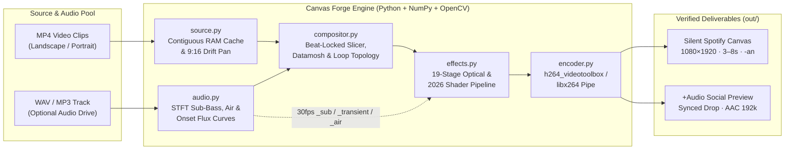

<div align="center">

# ✦ CANVAS FORGE `v2.5`

**Audio-Reactive Spotify Canvas & 2026 Visual Shader Studio**

[](https://www.python.org/)
[](#spotify-canvas-delivery-compliance)
[](#architecture--signal-flow)
[](LICENSE)

*Turn royalty-free stock footage and your own `.wav` / `.mp3` mixes into kinetic, sub-bass-driven, beat-locked **Spotify Canvas** loops (`1080×1920` portrait, `30 fps`, seamless loop) in seconds.*

</div>

---

## ⚡ Quickstart (Stupid Easy 1-Command Launch)

The only system prerequisite is `ffmpeg` (`brew install ffmpeg` on macOS or `sudo apt install ffmpeg` on Linux) and Python 3.10+.

```bash
git clone https://github.com/YOUR_USERNAME/canvas-forge.git
cd canvas-forge
./run.sh
```

**That's it.** `./run.sh` automatically:
1. Verifies `ffmpeg` is installed on your `PATH`.
2. Creates an isolated `.venv` virtual environment and installs `numpy` + `opencv-python-headless`.
3. Auto-discovers `.mp4` videos and `.wav` / `.mp3` audio mixes in your `~/Downloads` folder.
4. Launches the dark-mode **Canvas Forge Studio UI** in your browser at **`http://127.0.0.1:8765`**.

> Prefer `make` or standard `pip`? You can also run `make studio`, or `pip install -e . && canvasforge`.

---

## 🎛️ What Makes Canvas Forge Different

Most video scripts slap a static filter onto a single clip and export a broken cut. **Canvas Forge v2.5** is engineered like a modern hardware synth + VJ shader rack:

- **♫ Real-Time FFT Audio-Reactive Engine (`canvasforge/audio.py`)**
  Decodes any `.wav` or `.mp3` track via `ffmpeg` into `22.05 kHz` float32 PCM, runs a windowed STFT + onset-flux autocorrelation to detect **exact BPM**, locates the **loudest 8.0-second drop window**, and extracts 30fps per-frame modulation envelopes:
  - **Sub-Bass (`25–145 Hz`)** → drives camera zoom kicks, UV liquid wave warp, and vignette breathing.
  - **Percussive Transients (Spectral Flux)** → triggers slice glitches, chromatic RGB splits, and strobe impacts.
  - **High-Air (`2.4–10 kHz`)** → illuminates cyber-sigil Sobel contour wireframes.
- **✦ 19 Composable 2026 Shader & Optical Modules (`canvasforge/effects.py`)**
  Ordered 4×4 Bayer matrix dithering, warm red-orange analog CRT phosphor halation, slit-scan UV sine-wave displacement, 4-way kaleidoscope bar flips, prismatic RGB zoom trails, and organic 35mm film grain.
- **⚡ Optical-Flow Datamoshing & Beat-Locked Montage Cutting (`canvasforge/compositor.py`)**
  Slices across multiple source clips every `1`, `2`, `4`, or `8` beats using dense Farneback optical flow (`datamosh`) to smear outgoing motion vectors into incoming macroblocks, alongside `flash`, `whip`, `glitch`, and `luma` burns.
- **📱 Dual Export: Silent Spotify Master + Synced Audio Social Cut (`canvasforge/encoder.py`)**
  Spotify strictly rejects Canvas uploads that contain an audio track or exceed `8.0` seconds. Every render outputs:
  1. **`⬇ Silent Canvas MP4`** (`-an`, `1080×1920`, `yuv420p`, `3.0–8.0s`) ready for Spotify for Artists.
  2. **`⬇ +Audio Social MP4`** (`AAC 192kbps` synced to your track's drop) so you can audition with sound inside the Studio player (**`🔊 Audio: ON`**) or post directly to Instagram Reels, TikTok, and YouTube Shorts.

---

## 🏗️ Architecture & Signal Flow

Canvas Forge has **zero heavy web framework or GUI toolkit dependencies**—just `numpy`, `opencv-python-headless`, the Python standard library, and `ffmpeg`.



### Codebase Organization

```text
canvas-forge/
├── run.sh                   # 1-command zero-friction bootstrap & Studio launcher
├── Makefile                 # Shortcuts: make studio, make test, make list
├── pyproject.toml           # PEP 621 package metadata & `canvasforge` CLI entrypoint
├── requirements.txt         # Minimal pinned dependencies (numpy, opencv-python-headless)
├── canvasforge/
│   ├── __init__.py          # Public Python API exports & version (2.5.0)
│   ├── __main__.py          # `python -m canvasforge` entrypoint
│   ├── audio.py             # FFT audio analyzer: BPM autocorrelation, drop finder & 30fps curves
│   ├── source.py            # Video probing, contiguous RAM segment cache & 9:16 portrait drift-crop
│   ├── recipe.py            # Seeded recipe generator, pipeline ordering & 7 curated 2026 presets
│   ├── effects.py           # 19 beat-synced & audio-reactive optical/shader effects
│   ├── compositor.py        # Multi-clip beat montage timeline, Farneback datamosh & loop topologies
│   ├── encoder.py           # Apple Silicon VideoToolbox HW H.264 encoder & AAC audio muxer
│   ├── server.py            # Threaded HTTP Studio server with HTTP 206 Range streaming
│   ├── ui.html              # Lambda Audio obsidian dark-mode Studio UI (9:16 stage + safe zones)
│   └── cli.py               # Full-featured headless CLI for batch & automated rendering
└── tests/
    └── test_pipeline.py     # Unit tests covering all 19 shaders, 7 presets & 5 transitions
```

---

## 🎨 Curated 2026 Presets & 19 Shader Modules

### Style Presets (`--preset`)

| Preset ID | Studio Name | Visual Signature | Default Cut | Transition |
| :--- | :--- | :--- | :---: | :---: |
| `acid_dither` | **Acid Dither 2026** | Ordered 4×4 Bayer matrix dithering, glowing cyber-sigil contours, CRT halation & scanlines | `2 Beats` | `glitch` |
| `crt_melt` | **Analog CRT Melt** | Sub-bass liquid UV wave displacement, warm red-orange CRT phosphor halation & 35mm grain | `4 Beats` | `datamosh` |
| `hypnotic` | **Hypnotic Tunnel** | Beat-synced zoom kicks, prismatic RGB echoes, neon bloom & cinema contrast grade | `4 Beats` | `flash` |
| `kaleido` | **Kaleido Rave** | 4-way symmetrical geometry flips on the bar with HSV hue drift & strobe impacts | `2 Beats` | `whip` |
| `cyber_glitch` | **Cyber Glitch** | Aggressive slice displacement, RGB split, cyber contours & rapid 2-beat datamosh cuts | `2 Beats` | `datamosh` |
| `liquid_dream` | **Liquid Acid** | Fluid UV sine-wave warp, solarize highlights, prism trails & warm analog halation | `4 Beats` | `luma` |
| `dark_cinema` | **Dark Cinema** | Moody anamorphic contrast grade, subtle beat shake, film halation glow & heavy vignette | `4 Beats` | `luma` |

### 19 Composable Shaders (`canvasforge/effects.py`)

| Category | Effect Key | Studio Label | Description |
| :--- | :--- | :--- | :--- |
| **Motion** | `zoom_pulse` | Zoom Pulse | Breathing camera push + exponential kick zoom-in (zero border smearing) |
| **Motion** | `beat_bounce` | Beat Shake | Directional camera impact bounce on downbeats and kick transients |
| **Motion** | `liquid_warp` | Liquid Warp | Sub-bass driven 2D UV sine/cosine displacement field (`cv2.remap`) |
| **Geometry** | `mirror_quad` | Kaleido Mirror | 2-way / 4-way symmetrical reflection that flips axis on every bar |
| **Optics** | `prism_echo` | Prism Echo | Additive outward-expanding ghost layer with RGB channel offset |
| **Optics** | `neon_bloom` | Neon Bloom | Downsampled highlight extraction + Gaussian halation screen blend |
| **Optics** | `crt_halation` | CRT Halation | Authentic red-orange phosphor/emulsion light bleed around bright highlights |
| **Optics** | `chroma_pulse` | Chroma Split | Beat-synced radial & horizontal RGB chromatic aberration |
| **Digital** | `bayer_dither` | Bayer Dither | Ordered 4×4 Bayer matrix dithering + quantized bit-depth reduction |
| **Digital** | `edge_neon` | Cyber Contours | Glowing electric-mint & violet Sobel edge wireframes driven by high-air |
| **Digital** | `glitch` | Slice Glitch | Horizontal scanline block displacement + random channel inversion |
| **Color** | `solarize_pulse` | Acid Solarize | Partial highlight inversion pulsed on every 2nd beat |
| **Color** | `hue_cycle` | Hue Drift | Continuous HSV hue rotation across the loop |
| **Color** | `color_grade` | Cinema Grade | Linear S-curve contrast pump with warm/cool split-toning |
| **Texture** | `vignette` | Vignette | Cached radial falloff mask that breathes with the sub-bass |
| **Texture** | `scanlines` | CRT Scanlines | Rolling cathode-ray scanline darkening |
| **Texture** | `grain` | 35mm Grain | Clumped half-resolution organic film noise |
| **Texture** | `letterbox` | Cinema Bars | Beat-breathing top/bottom anamorphic mattes |
| **Impact** | `flash` | Beat Strobe | Sharp exponential exposure spike on downbeats |

---

## 💻 Headless CLI & Batch Usage

In addition to the interactive web Studio, you can script or batch-render directly from the terminal:

```bash
# Launch interactive Studio UI (default when no video paths are passed)
./run.sh

# Render an 8.0s 1080x1920 Master Canvas synced to an audio track with Optical-Flow Datamoshing
./run.sh ~/Downloads/clip1.mp4 ~/Downloads/clip2.mp4 \
  --audio ~/Downloads/my_track.wav \
  --preset crt_melt \
  --transition datamosh \
  --loop-mode rebound \
  --duration 8.0 \
  --seed 2026 \
  -o out/my-canvas.mp4

# List all 7 presets and 19 shader modules
./run.sh --list

# Run the automated unit test suite
make test
```

---

## ✅ Spotify Canvas Delivery Compliance

Every Master export produced by Canvas Forge is automatically verified against [Spotify's official Canvas technical specifications](https://canvas.spotify.com/):

- **Aspect Ratio & Resolution**: `9:16` vertical portrait at `1080 × 1920` pixels (`540 × 960` in fast preview mode).
- **Duration**: Strictly bounded between **`3.0s` and `8.0s`** (`4.0s`, `6.0s`, or `8.0s` selectable in UI; `240` frames @ `30 fps`).
- **Codec & Pixel Format**: `H.264` (`High@L4.0`), `yuv420p`, progressive scan, `+faststart` moov atom.
- **Audio Strip**: The primary Canvas MP4 is strictly silent (`-an`) so Spotify's ingestion validator never rejects it, while the optional `-audio.mp4` companion file lets you preview and share with sound.
- **Safe Zone Overlay**: Toggleable `14%` top header and `33%` bottom player-control crop guides directly on the 9:16 Studio viewport.

---

## 📄 License

Released under the [MIT License](LICENSE).
