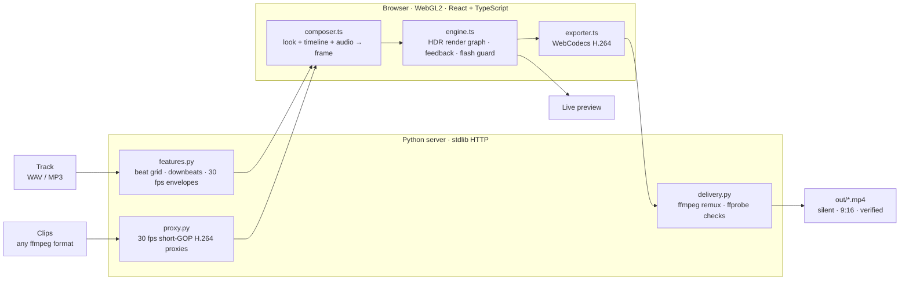

# Downbeat

A local app for making Spotify Canvas loops that cut and move with your song.

[](#whats-new-in-v4)
[](https://www.python.org/)
[](#how-it-works)
[](#spotify-canvas--motion-delivery)
[](LICENSE)

Downbeat makes Spotify Canvas loops from your video clips and your song. It finds the tempo and downbeats and suggests where the loop should start. You build the look while the track plays, and the export is a silent 9:16 MP4 that's checked against Spotify's Canvas requirements.


[Quickstart](#quickstart) · [Installation](#installation) · [Studio workflow](#studio-workflow) · [Looks & effects](#looks-effects--transitions) · [Delivery](#spotify-canvas--motion-delivery) · [Architecture](#how-it-works) · [CLI](#headless-cli)

---

## What's new in v4

The studio now renders on your GPU in the browser (WebGL2), so changes show up while the song plays. Exports use the same renderer as the preview, so the file matches what you saw frame for frame.

- Tempo detection to 0.02 BPM, with downbeats and eight audio envelopes at 30 fps: kick, snare, hats, bass, energy, brightness, vocals and presence.
- Any slider can follow one of those envelopes, a tempo-synced clock, two LFOs you set the shape, rate and phase of, a 16-step sequencer, an envelope you draw, or one of two macro knobs.
- 49 effects and 44 looks: 18 studio looks, 8 for album art and stills, and the classic studio's 18 presets rebuilt for the GPU.
- Stills and cover art get a fake-depth parallax effect, plus an optional spectrum visualizer.
- Auto-framing centers each clip on its subject. You can also drag the preview to reframe, slip a segment to a different moment of its clip, and add speed ramps that follow the beat.
- Roll (`D`) randomizes the look, a 4 to 6 layer effect stack, the edit and the per-clip effects at once. Variations (`M`) shows six mutations of the current look.
- Each clip can use the main look, a mutated copy of it, or its own stack.
- Cuts snap to the beat grid, and the 16 transitions are centered on the beat.
- Loops are always whole bars, and anything that cycles completes a whole number of cycles per loop, so nothing jumps at the loop point.
- You can pull a five-color palette from your cover art and apply it to a look.
- Besides Spotify Canvas, you can export Apple Music motion art (3:4 and 1:1), a 16:9 YouTube visualizer with the song, a square social clip, 3000 px cover art, GIF and WebP previews, and artist banners for Spotify, YouTube and SoundCloud. Each file is checked with ffprobe, and video loops also get a loop-seam and flash-rate check.

The headless CLI still runs on the original NumPy/OpenCV engine.

---

## Quickstart

If you already have git, Python 3.10+, ffmpeg and Node.js 20.19+ installed:

```bash
git clone https://github.com/J-Reed700/canvas.git
cd canvas
./run.sh
```

The studio opens at http://127.0.0.1:8765. On a new computer without those tools, see [Installation](#installation). `./run.sh` can install them for you.

---

## Installation

### What gets installed

| Tool | What it's for | Version | Installed by `./run.sh` |
| :--- | :--- | :--- | :--- |
| Web browser | Runs the studio (WebGL2 rendering, WebCodecs export) | Chrome or Edge recommended | No, install it yourself |
| git | Downloading the code and updates | any | No, or use [the ZIP](#no-git-download-the-zip) |
| ffmpeg and ffprobe | Playback proxies, writing and checking exports | any recent release | Yes |
| Python | The local server, tempo detection, auto-framing | 3.10 or newer | Yes |
| Node.js and npm | Building the studio UI (React, Vite, TypeScript) | 20.19+ or 22.12+ | Yes |
| Python packages | `numpy`, `opencv-python-headless` | from `pyproject.toml` | Yes, into `.venv/` in the project folder |
| npm packages | `react`, `react-dom`, `zustand`, `vite`, `typescript` | from `package-lock.json` | Yes, into `node_modules/` in the project folder |

The Python and npm packages take about 250 MB and live inside the project folder. On a new Mac, Homebrew plus ffmpeg, Python and Node add roughly another 1 GB.

### What `./run.sh` does

Every time you run it, `./run.sh` goes through these steps and skips anything that's already done:

1. Looks for ffmpeg, Python 3.10+ and Node.js 20.19+. If one is missing, it asks before installing it. On macOS it uses [Homebrew](https://brew.sh) and offers to install Homebrew first if you don't have it. On Linux it uses `apt`, `dnf`, `pacman` or `zypper`, and installs Node.js with [nvm](https://github.com/nvm-sh/nvm) into `~/.nvm` without sudo, because distro Node packages are usually too old for Vite.
2. Creates `.venv/`, a private Python environment, and installs the Python packages into it. It reinstalls them when `pyproject.toml` changes.
3. Runs `npm ci` when `node_modules/` is missing or `package-lock.json` has changed.
4. Builds the studio UI into `downbeat/studio/dist/` when there's no build yet or a studio source file is newer than the last one.
5. Starts the server and opens http://127.0.0.1:8765 in your browser.

The first run takes 1 to 5 minutes, depending on what needs installing. After that it starts in about a second.

| Command | What it does |
| :--- | :--- |
| `./run.sh` | Sets up anything missing, then opens the studio |
| `./run.sh --setup` | Installs and builds without starting the studio |
| `./run.sh --yes` | Installs missing tools without asking (same as `DOWNBEAT_YES=1`) |
| `./run.sh --port 8766` | Uses a different port. Other flags go to `python -m downbeat` |
| `./run.sh --no-browser` | Starts the server without opening a browser tab |
| `./run` or `make studio` | Same as `./run.sh` |

### macOS, starting from a new Mac

This works on Apple Silicon and Intel Macs running any macOS version that Homebrew supports, which is the three most recent releases.

1. Open Terminal: press `⌘ Space`, type Terminal and press Return. Paste each command below and press Return after it.

2. Install Homebrew, the usual macOS package manager. It also installs Apple's Command Line Tools, which include git.

   ```bash
   /bin/bash -c "$(curl -fsSL https://raw.githubusercontent.com/Homebrew/install/HEAD/install.sh)"
   ```

   It asks for your Mac login password. Nothing appears while you type it; that's normal. Press Return when it asks you to continue. This takes 5 to 15 minutes.

3. On Apple Silicon Macs, add Homebrew to your PATH. The installer prints these lines under "Next steps":

   ```bash
   echo >> ~/.zprofile
   echo 'eval "$(/opt/homebrew/bin/brew shellenv)"' >> ~/.zprofile
   eval "$(/opt/homebrew/bin/brew shellenv)"
   ```

   Intel Macs can skip this step. Run `brew --version` to check that it worked.

4. Install the tools. You can skip this, because `./run.sh` offers to do it, but doing it now gets the waiting out of the way:

   ```bash
   brew install git python@3.12 ffmpeg node
   ```

5. Download Downbeat into your home folder and start it:

   ```bash
   cd ~
   git clone https://github.com/J-Reed700/canvas.git
   cd canvas
   ./run.sh
   ```

6. If you don't have Google Chrome, install it from [google.com/chrome](https://www.google.com/chrome/). The studio opens in your default browser. If that's Safari, copy the address into Chrome.

Next time, open Terminal and run `cd ~/canvas && ./run.sh`. Press `Ctrl + C` in Terminal to stop the server.

### Windows 10 and 11, using WSL

On Windows the server runs inside WSL (Windows Subsystem for Linux, which gives you an Ubuntu install). The studio runs in your normal Chrome or Edge, so it still uses your graphics card. Running it straight from PowerShell or Command Prompt isn't supported.

1. Install WSL. Right-click Start, choose Terminal (Admin) or Windows PowerShell (Admin), and run:

   ```powershell
   wsl --install
   ```

   Restart when it asks. After the restart an Ubuntu window opens and asks you to pick a Linux username and password. You'll need that password whenever a command uses `sudo`.

2. In the Ubuntu window, install git and curl, then download and start Downbeat:

   ```bash
   sudo apt update && sudo apt install -y git curl
   cd ~
   git clone https://github.com/J-Reed700/canvas.git
   cd canvas
   ./run.sh
   ```

   `./run.sh` asks to install ffmpeg and Python with `apt`, which needs your Linux password, and Node.js with nvm. Answer Y each time.

3. WSL can't open a browser tab for you. Open Chrome or Edge on Windows and go to http://localhost:8765.

4. Drag clips, images and tracks from File Explorer into the studio. Exports download to your Windows Downloads folder. Copies also stay in `\\wsl$\Ubuntu\home\<your-linux-name>\canvas\out`, which you can paste into File Explorer's address bar.

Next time, open Ubuntu from the Start menu, run `cd ~/canvas && ./run.sh`, and go to http://localhost:8765.

### Linux

Ubuntu 22.04 and later, Debian 12 and later, Fedora 39 and later, Arch and openSUSE all come with Python 3.10 or newer. Install git and curl, and `./run.sh` handles the rest:

```bash
# Ubuntu, Debian, Mint, Pop!_OS
sudo apt update && sudo apt install -y git curl

# Fedora
sudo dnf install -y git curl

# Arch, Manjaro
sudo pacman -S --needed git curl
```

```bash
cd ~
git clone https://github.com/J-Reed700/canvas.git
cd canvas
./run.sh
```

`./run.sh` installs ffmpeg and Python's venv module (`python3-venv` on Debian and Ubuntu) with your package manager, and Node.js LTS with nvm. Fedora's default `ffmpeg-free` can't encode H.264 with x264, so on Fedora it offers to enable [RPM Fusion](https://rpmfusion.org/) and switch to the full ffmpeg. If your distribution's Python is older than 3.10, install a newer one first (for example with [pyenv](https://github.com/pyenv/pyenv)), then run `PYTHON=python3.12 ./run.sh`.

### No git? Download the ZIP

On the [GitHub page](https://github.com/J-Reed700/canvas), click Code, then Download ZIP. Unzip it, then in a terminal:

```bash
cd ~/Downloads/canvas-main
chmod +x run.sh
./run.sh
```

To update, download the ZIP again. If you want to keep your old exports, copy the `out/` folder across.

### Setting it up by hand

If you'd rather not use `./run.sh`, install ffmpeg, Python 3.10+ and Node.js 20.19+ yourself, then run:

```bash
python3 -m venv .venv
./.venv/bin/python -m pip install --upgrade pip
./.venv/bin/python -m pip install -e .
npm ci
npm run build
./.venv/bin/python -m downbeat --studio
```

### Checking the install

```bash
ffmpeg -version | head -n 1    # any recent version
python3 --version              # 3.10 or newer
node --version                 # v20.19 or newer (v22.18+ to run the JS tests)
./run.sh --setup               # ends with "Setup complete"
make test                      # runs the Python and studio test suites
```

Then open the studio and press Space. Your clips should play, and the FPS counter under the preview should read about 60. If the preview stays black, see [Troubleshooting](#troubleshooting).

### Updating

```bash
cd ~/canvas
git pull
./run.sh
```

`./run.sh` sees what changed and only reinstalls or rebuilds that.

### Uninstalling

Everything Downbeat installs lives in its own folder: `.venv/`, `node_modules/`, `downbeat/studio/dist/`, and your exports in `out/`. Delete the folder to remove it:

```bash
rm -rf ~/canvas
```

ffmpeg, Python and Node are shared tools, so it's up to you whether to remove them. On macOS that's `brew uninstall ffmpeg node python@3.12`, on Ubuntu `sudo apt remove ffmpeg`, and nvm's Node goes with `rm -rf ~/.nvm`.

### Troubleshooting

| Problem | Fix |
| :--- | :--- |
| `permission denied: ./run.sh` | Run `chmod +x run.sh` once, or start it with `bash run.sh`. |
| `command not found: brew` right after installing Homebrew | Run the three lines from [step 3 of the macOS setup](#macos-starting-from-a-new-mac), or open a new Terminal window. |
| `xcrun: error: invalid active developer path` | The Command Line Tools are missing, which can happen after a macOS update. Run `xcode-select --install`. |
| `ensurepip is not available` or `No module named venv` | Debian and Ubuntu package this separately. Run `sudo apt install python3-venv`, then `rm -rf .venv && ./run.sh`. `./run.sh` normally does this for you. |
| `Vite requires Node.js version 20.19+ or 22.12+` | Your Node is too old. Run `brew upgrade node` on macOS, or `nvm install --lts` on Linux and WSL. |
| `npm ERR! EACCES` | Don't use `sudo` with npm here. Run `rm -rf node_modules && ./run.sh`. |
| `pip` fails with `SSL: CERTIFICATE_VERIFY_FAILED` | If your Python came from python.org, run Install Certificates.command in `/Applications/Python 3.x/`, or use Homebrew's Python. |
| The browser didn't open | Go to http://127.0.0.1:8765 yourself. The terminal prints the exact address. If port 8765 is busy, the server uses the next free one. |
| `Address already in use`, or an old copy is still running | Running `./run.sh` again replaces a Downbeat server that's already running. To use another port, run `./run.sh --port 8766`. |
| On WSL, http://localhost:8765 doesn't load in Windows | Update WSL with `wsl --update` in PowerShell. If that doesn't fix it, add `networkingMode=mirrored` under `[wsl2]` in `%UserProfile%\.wslconfig` and run `wsl --shutdown`. |
| The preview stays black, or the browser console says `WebGL2 is not available` | In Chrome, open Settings, then System, turn on "Use graphics acceleration when available" and relaunch. `chrome://gpu` should list WebGL2 as hardware accelerated. On Windows, update your graphics driver. |
| Export fails with an error about `VideoEncoder` or WebCodecs | Update Chrome or Edge. Without hardware H.264 the studio sends raw frames to ffmpeg instead. That's slower, but it works. |
| The studio looks out of date after `git pull` | `./run.sh` rebuilds it. To force a rebuild, run `rm -rf downbeat/studio/dist && ./run.sh`. |
| Clips stay on "Preparing" | Playback proxies are still building in the background, and 4K files take longer. They're stored in `out/.proxies/` and are safe to delete. |
| You want to start completely fresh | Run `rm -rf .venv node_modules downbeat/studio/dist && ./run.sh`. |

### Where your files go

You can drop videos (`.mp4 .mov .m4v .webm .mkv`), images (`.jpg .png .webp`) and songs (`.wav .mp3 .flac .m4a .aac .aif .ogg .opus`) onto the studio, or use + Add clips, art or tracks. Uploads are copied to `out/uploads/` and stay in the library after a restart. When it starts, the studio also picks up recent `.mp4` clips from `~/Downloads`. The Track menu lists every song in `~/Downloads` plus any music folders you add from the menu (saved in `out/.library.json`), and it has a search box.

Finished exports download to your browser's Downloads folder. A copy stays in `out/`, along with any `-audio.mp4` and `-promo-*.mp4` files, named `canvas-<look>-<bpm>bpm-<length>s-<size>-<timestamp>.mp4`.

---

## Studio workflow

A walkthrough of every panel and control is in [docs/STUDIO_GUIDE.md](docs/STUDIO_GUIDE.md). The short version:

1. Add clips and a track with + Add clips, art or tracks, or drop files anywhere on the window. Drag clips to reorder them. Playback proxies (30 fps H.264 with frequent keyframes) build in the background so scrubbing stays smooth.
2. Pick the loop. The track panel shows the tempo and suggested starting points such as Drop, Peak and Intro. Choose 1, 2, 4 or 8 bars, or drag the highlighted region along the waveform. For a visualizer, the Edit tab takes any number of bars, a time such as 2:30, or Whole song. If the tempo is wrong, use ½×, 2× or Tap, or type the BPM.
3. Choose a look in the Looks tab. `D` rolls a new look and edit, `M` shows variations of the current look, and `R` picks a random preset. `Cmd+Z` undoes any change.
4. Adjust it in the Layers tab: overall FX intensity, per-clip looks, and each effect layer. The dot next to a slider sets what moves it: an audio band, a tempo clock, LFO A or B, the step sequencer, your drawn envelope or a macro. You edit the LFOs, envelope, steps and macros in the Modulators card on the same tab. Camera covers zoom, drift, shake and clip speed. Finish covers the color grade, grain, vignette and cinema bars.
5. Shape the edit in the Edit tab: cut rhythm, which transitions to use, clip direction and speed ramps. On the timeline, drag a cut to move it along the beat grid, `Alt`-drag a segment to use a different part of its clip, or double-click a segment to change just that one.
6. Listen. Loop plays only the slice of the song under the canvas. Listener lets the song keep playing while the canvas loops, which is what a listener sees. `H` shows the Spotify player overlay and `S` the safe zones.
7. Export with `E`. Pick a format, render, and read the checks. The file downloads to your Downloads folder, and a copy stays in `out/`.

### Keyboard shortcuts

| Key | Action | Key | Action |
| :--- | :--- | :--- | :--- |
| `Space` | Play / pause | `E` | Export |
| `Left` / `Right` | Previous / next look | `[` / `]` | Previous / next loop suggestion |
| `M` | Look variations | `1`–`4` | Loop length presets (1, 2, 4, 8 bars) |
| `D` | Roll a new look and edit | `Shift` `D` | Undo the last roll |
| `Cmd+Z` / `Shift+Cmd+Z` | Undo / redo | `T` | Tap tempo |
| `R` | Random look | `L` | Toggle Loop / Listener mode |
| `H` | Toggle Spotify overlay | `S` | Toggle safe zones |
| `?` | Keyboard help | `Esc` | Close the open panel |

---

## Looks, effects & transitions

### 44 looks

Studio looks are short stacks: one main effect, sometimes a second one, and a color grade.

| Look | Layers | Description |
| :--- | :--- | :--- |
| Liquid Chrome | glass · chrome · bloom | Rippling glass over a chrome finish |
| Neon Kaleidoscope | kaleido · trails · bloom | Six-way kaleidoscope with light trails |
| Hyperspace | trails · chroma · bloom | Feedback tunnel that zooms in on each kick |
| 1-Bit Signal | dither · glitch | Black-and-white dither that glitches on the snare |
| Acid Rave | ripple · dither | Colored dither with a ripple on every beat |
| Super 8 Memory | leak · bloom | Warm home-movie film with light leaks |
| VHS Afterhours | lens · vhs | Tape bleed, fisheye and a rolling tracking line |
| Thermal Vision | gradient · edges · bloom | Heat-camera colors with glowing edges |
| Halftone Riot | posterize · halftone | Posterized color printed as CMYK dots |
| Datamosh Dream | liquid · echo · glitch | Liquid warp with color-split motion echoes |
| Golden Rays | rays | Light rays streaming out of the bright areas |
| Pixel Sort Acid | pixelsort · gradient · chroma | Bright pixels dragged into long sorted streaks |
| Glyph Terminal | ascii · bloom · crt | The picture redrawn in glowing text characters |
| Iridescent Pulse | ripple · holo · bloom | Holographic sheen with a ripple on the beat |
| Anamorphic Night | streaks · chroma | Teal and orange grade, blue lens streaks, letterbox |
| Mirror World | mirror · glass · hue | Four-way mirror seen through soft glass |
| Clone Wall | tile · zoomblur | A sliding wall of copies that jumps on the kick |
| Clean Cut | bloom | Your footage, color graded and cut on the beat |

Album art & stills looks are made for a single image, such as cover art. They use the 2.5D Parallax effect for depth and a slow camera move. Track Visualizer adds a spectrum ring.

| Look | Layers | Description |
| :--- | :--- | :--- |
| Living Cover Art | parallax · pulse · bloom | Parallax depth with a warm glow that swells with the vocals |
| Track Visualizer | parallax · visualizer · bloom | A spectrum ring over the cover art, pulsing on the kick |
| Cover Breathe | parallax · pulse · bloom | Slow parallax orbit with a soft pulse on the kick |
| Cover Sparkle | parallax · glint · leak | Parallax with star glints and a drifting light leak |
| Cover Dream | parallax · liquid · ghost · bloom | Parallax with a slow liquid melt and a warm glow |
| Cover on Tape | parallax · stutter · vhs · chroma | Parallax on VHS tape that freezes briefly on the kick |
| Cover Glitch | parallax · glitch · chroma · bloom | Parallax broken up by glitches on the snare |
| Cover Halo | parallax · rays · frost · filmstock | Light rays through the art with a frosted, golden grade |

Classic stacks are the classic studio's 18 presets rebuilt for the GPU. The old presets used separate shaders for zoom pulse, shake, grade, vignette, grain, halation and letterbox; here the Camera and Finish stages handle those.

| Look | Layers | Description |
| :--- | :--- | :--- |
| Hypnotic Tunnel | tunnel · echo · chroma · bloom | Tunnel with prism echoes and a color split on the kick |
| Acid Dither 2026 | dither · edges · crt | Dither with neon outlines and CRT scanlines |
| Analog CRT Melt | liquid · chroma · crt · bloom | Liquid warp on an old CRT screen, with grain |
| Kaleido Rave | mirror · hue · chroma · bloom | Four-way mirror cycling through the color wheel |
| Cyber Glitch | glitch · edges · chroma · bloom | Block glitches and neon outlines, shaking on the beat |
| Liquid Acid | liquid · echo · solarize · bloom | Fluid warp with trails and solarized highlights |
| Dark Cinema | filmstock · bloom · streaks | Teal and orange with a heavy vignette and a shake on the beat |
| VHS Retro Rewind | lens · vhs · crt | Tape tracking errors with scanlines and grain |
| Neon Tokyo 2026 | echo · edges · filmstock · bloom | Cyberpunk colors with neon outlines and trails |
| Solar Flare | solarize · filmstock · streaks · pulse | Lens flares and solarized gold, with a warm pulse on the kick |
| Matrix Data Stream | ascii · glitch · chroma · bloom | Glowing text characters torn up by glitches |
| Prism Velocity | zoomblur · echo · chroma · bloom | Zoom blur on the kick with prism trails |
| Thermal Infrared | ripple · gradient · bloom | Infrared heat map with shockwaves on the bass |
| Duotone Acid Punk | gradient · dither · edges · pulse | Two-color acid palette with outlines and dither |
| 35mm Noir | filmstock · leak · bloom | Sepia film with light leaks and a letterbox |
| Kaleido Vortex | kaleido · vortex · hue · bloom | Six-sided kaleidoscope that twists on the kick |
| Sub-Bass Quake | ripple · chroma · bassrim | Shockwaves and a heavy shake on the bass |
| Cosmic Hyperdrive | tunnel · echo · glint · bloom | Star tunnel with prism trails and glints |

### 49 effects

| Category | Effects |
| :--- | :--- |
| Space | 2.5D Parallax · Kaleidoscope · Mirror · Infinite Tunnel · Clone Grid · Fisheye · Ribbon Split · Little Planet · B-Roll Blend |
| Warp | Liquid Flow · Liquid Glass · Shockwave · Vortex · Zoom Blur · Gravity Melt |
| Time | Feedback Trails · Chroma Echo · Slit Scan · Datamosh Smear · Stutter |
| Light | Bloom · Anamorphic Flare · God Rays · Spectral Aberration · Light Leak · Star Glint · Tilt Shift · Double Vision · Warm Pulse · Beat Shutter · Bass Rim |
| Stylize | 1-Bit Dither · Halftone · Pixel Sort · Glyph Matrix · Data Glitch · VHS Tape · CRT Monitor · Neon Contours · Mosaic · Frost Mist · Audio Visualizer |
| Color | Gradient Map · Holographic · Liquid Chrome · Hue Orbit · Posterize · Solarize · Film Stock |

Together with Camera and Finish, these cover all 52 of the classic studio's shaders. Beat Shutter only dims the picture, never below half brightness and at most once per beat, so it stays photosafe.

Every look also has a Camera stage (zoom, drift, shake, sway and clip speed) and a Finish stage (exposure, halation, temperature and tint, tone mapping, contrast, saturation, split toning, fade, vignette, grain and cinema bars).

### 16 transitions

Light Dissolve · Luma Burn · Zoom Punch · Whip Pan · Whip Sideways · Block Glitch · Datamosh · Shock Ripple · Iris Bloom · Pixel Melt · Vortex · Prism Split · Light Leak · Shutter Slices · Kaleido Fold · Flow Morph, plus a hard cut. Each one is centered on its beat, so the change lands on the hit.

---

## Spotify Canvas & motion delivery

Every export is checked against the requirements of the format you picked. Finished files download to your browser's Downloads folder, and a copy stays in `out/`.

### Formats and sizes

Spotify's [Canvas guidelines](https://support.spotify.com/us/artists/article/canvas-guidelines/) ask for a 3 to 8 second, 9:16 MP4 that is 720 to 1080 px tall. Spotify plays your song itself, so the Canvas file has no audio.

| Size | Aspect | Use it for |
| :--- | :---: | :--- |
| 1080×1920 | 9:16 | Spotify Canvas, at the size most people upload |
| 720×1280 | 9:16 | A smaller Canvas file |
| 608×1080 | 9:16 | Spotify's listed height range, exactly. Use it if an upload is rejected |
| 2048×2732 | 3:4 | Apple Music motion art, portrait |
| 3840×3840 | 1:1 | Apple Music motion art, square (rendered at 2048 and upscaled) |
| 1920×1080 | 16:9 | A YouTube visualizer with the song |
| 1080×1080 | 1:1 | A square video loop for social feeds |
| 3000×3000 | 1:1 | Still cover art, as an sRGB JPG |
| 2660×1140, 2560×1440, 2480×520 | Banner | Artist banners for Spotify, YouTube and SoundCloud, framed on the subject |
| GIF or WebP | Loop | Small animated previews for places that don't play video |

### Promo clips and batch export

A Spotify Canvas export can also make a 15 or 30 second promo: the loop repeated with the song playing underneath, for Reels, TikTok or Shorts.

Loops longer than 8 seconds, up to the whole song, are for YouTube 16:9 and Social 1:1 exports. Spotify and Apple Music have length limits of their own, and the export sheet warns when a loop doesn't fit. Videos over a minute are encoded at 20 Mbps, and every export streams to disk as it renders.

Batch export renders four random rolls of the current edit, or the current look on every track in your library.

### What each export is checked for

After an export, ffprobe inspects the file and the studio lists the results:

- Length: 3 to 8 s for a Canvas and at most 35 s for Apple Music. YouTube and Social files can be any length
- Aspect: 9:16, or 3:4 and 1:1 for Apple Music
- Codec: H.264, yuv420p, constant 30 fps
- Audio: none in Canvas and Apple Music files. Only promos and the `-audio` copy have sound
- Fast start: the `moov` atom comes before `mdat`, so playback can begin before the file finishes downloading
- Loop seam: the jump from the last frame back to the first, compared with the loop's normal frame-to-frame change
- Flashes: brightness flashes per second, over the whole frame and in each quarter of it

Spotify's height range and the common 1080×1920 size disagree, so the checklist adds a note to anything taller than 1080 px. If Spotify ever rejects an upload for its size, export again at 608×1080.

### Photosensitivity

The Finish stage includes a flash guard that limits how much the average brightness can change from one frame to the next. The export report counts flashes per second against the three-per-second guideline.

---

## How it works



### Architecture notes

- `compose(ctx, t)` turns the look, the timeline and the audio at time `t` into a description of one frame. The live preview, the look thumbnails and the exporter all call it, so they can't drift apart.
- Audio analysis runs an FFT with a 30 fps hop to get the band envelopes and a kick-weighted onset curve. Tempo comes from a search over 70 to 180 BPM, refined to 0.02 BPM, and the kicks set the beat phase and downbeats. A tempo in the filename (`track_145bpm.wav`) overrides the detected one.
- Each clip is transcoded once to constant 30 fps H.264 with a keyframe every 8 frames, so the exporter can seek to any frame exactly.
- Loops are a whole number of bars. The loop point is treated as a beat-centered cut on the first downbeat, noise patterns cross-fade over one loop, and feedback effects run for a full loop before recording starts.
- The browser encodes H.264 with WebCodecs and sends the stream to the server, where ffmpeg wraps it in an MP4 without re-encoding. Browsers without WebCodecs send raw frames to ffmpeg instead.
- The server only listens on 127.0.0.1 and rejects requests whose Host or Origin header isn't local.

### Project layout

```text
canvas/
├── run.sh · run · Makefile     # one-command launcher and shortcuts
├── pyproject.toml              # package metadata and the `downbeat` entry point
├── downbeat/
│   ├── cli.py                  # command line: renders a canvas with the CPU engine
│   ├── delivery.py             # export formats, Annex B remux, cover art, banners, GIF/WebP, spec checks
│   ├── media/                  # source.py (probe, thumbnails, stills), proxy.py (30 fps playback proxies), encoder.py (ffmpeg)
│   ├── analysis/               # audio.py (decoding, tempo, envelopes), features.py (beat grid, loop suggestions),
│   │                           #   framing.py (subject auto-framing, color palettes)
│   ├── render/                 # the command line's CPU renderer: compositor.py, recipe.py, effects/ (NumPy/OpenCV)
│   ├── server/                 # the studio's backend
│   │   ├── app.py              #   HTTP routes: media, features, proxies, the export API
│   │   ├── state.py            #   clips, songs and exports, and export sessions
│   │   └── library.py          #   song library: Downloads, added songs, your music folders
│   └── studio/                 # the WebGL2 studio (TypeScript, React, Zustand, Vite)
│       ├── index.html · styles.css
│       └── src/
│           ├── main.tsx · App.tsx   # React root, layout and keyboard shortcuts
│           ├── engine/         # no React: WebGL2 render graph, GLSL, the GPU effects and looks, compose(),
│           │                   #   cut planning, Web Audio transport, WebCodecs export
│           ├── state/          # Zustand store, plus history, roll, export and media actions
│           ├── canvas/         # per-frame drawing: the render loop, the timeline lane and overview
│           ├── lib/            # helpers, export formats, export search and paging
│           └── components/     # the panels, plus shared Slider, Card and SearchField (ui.tsx)
└── tests/
    ├── test_pipeline.py        # classic engine
    ├── test_studio.py          # beat grid, loop lengths, remux, verifier, proxies
    ├── test_server.py          # every HTTP route, uploads, streamed exports, launch and relaunch
    ├── test_cli.py             # command-line options and a small real render
    ├── test_backend_units.py   # probing, encoding, audio analysis, delivery, state, proxies
    ├── studio.test.mjs         # timeline, modulation, looks, flash counter (node --test)
    ├── studio_store.test.mjs   # loop lengths, per-clip looks, undo, rolls, uploads, clip actions
    ├── studio_media.test.mjs   # audio transport, video bank, export streaming, timeline lane
    ├── studio_export.test.mjs  # export sheet: format settings, progress, cancel, batches
    ├── studio_render.test.mjs  # preview loop: redraws, readouts, meters, step grid, slider markers
    ├── studio_utils.test.mjs   # helpers and the exports browser's search and sort
    └── fakes.mjs               # stand-ins for the DOM, <video>, canvas, fetch and WebCodecs
```

### Development

```bash
make test               # Python suite, plus the JS suite when Node is installed
node --test tests/*.test.mjs        # just the studio's JS tests (Node 22.18+ runs the .ts modules directly)
npm run typecheck       # TypeScript check without building
npm run dev             # Vite dev server with hot reload; start ./run.sh first, it proxies /api and /out to :8765
npm run build           # production build into downbeat/studio/dist (./run.sh does this when sources change)
```

---

## Headless CLI

The NumPy and OpenCV engine has its own set of 18 presets, 52 shaders, 14 transitions and 4 loop topologies. It drives the headless CLI, which is handy for batch jobs and scripts.

<details>
<summary><b>CLI usage and flag reference</b></summary>

#### Basic commands

```bash
# Launch interactive Studio UI (default when no videos are passed)
./run.sh

# List all 18 presets and 52 shader modules
./run.sh --list

# Inspect a generated recipe without rendering
./run.sh clip1.mp4 clip2.mp4 --preset hypnotic --dry-run
```

#### Examples

##### Four clips cut to a track with a mix of transitions
```bash
./run.sh clip1.mp4 clip2.mp4 clip3.mp4 clip4.mp4 \
  --audio track.wav \
  --preset hypnotic \
  --cut-beats 2.0 \
  --cut-mode syncopated \
  --transitions datamosh whip zoom_punch prism_split \
  --transition-mode random \
  --trans-frames 12 \
  --loop-mode morph \
  --out out/kinetic-canvas.mp4
```

##### Effects that change from clip to clip
```bash
./run.sh intro.mp4 drop.mp4 solo.mp4 outro.mp4 \
  --audio master.mp3 \
  --filter-mode evolve \
  --cut-mode build_up \
  --clip-direction alternate \
  --duration 8.0 \
  --out out/evolved-canvas.mp4
```

##### A different preset per clip, with a rebound loop
```bash
./run.sh synth.mp4 guitar.mp4 drums.mp4 \
  --audio live.wav \
  --filter-mode preset_cycle \
  --cut-mode fit_all_2x \
  --loop-mode rebound \
  --speed 1.25 \
  --out out/rebound-canvas.mp4
```

##### One Canvas per clip
```bash
# Makes a separate Canvas from each of clip1.mp4, clip2.mp4 and clip3.mp4
./run.sh clip1.mp4 clip2.mp4 clip3.mp4 \
  --separate \
  --preset crt_melt \
  --duration 6.0
```

#### All flags

| Flag | Default | Description |
| :--- | :--- | :--- |
| `videos ...` | *(interactive)* | Input MP4 video paths. If omitted, launches the Studio UI |
| `-o, --out` | `out/sample-canvas.mp4` | Destination filepath for exported `.mp4` master |
| `--studio` | `False` | Start the studio |
| `--port` | `8765` | Studio local HTTP server port |
| `--no-browser` | `False` | Don't open a browser tab when the studio starts |
| `--audio` | `None` | A `.wav` or `.mp3` track to sync the cuts and effects to |
| `--preset` | `None` | Style preset (see [Presets](#presets---preset)) |
| `--seed` | *(random)* | Recipe seed. The same seed gives the same render |
| `--bpm` | *(auto)* | Explicit BPM override (auto-detected when `--audio` is supplied) |
| `--duration` | `8.0` | Spotify Canvas loop length in seconds (`3.0` to `24.0`) |
| `--loop-mode` | `crossfade` | How the loop point joins: `crossfade`, `rebound`, `morph`, `hard` |
| `--cut-beats` | `4.0` | Beat interval between cuts (e.g. `0.5`, `1.0`, `2.0`, `4.0`) |
| `--cut-mode` | `steady` | Rhythm mode: `steady`, `fit_all`, `fit_all_2x`, `build_up`, `syncopated`, `transient`, `chaos` |
| `--ensure-all-clips` | `True` | Makes sure every input clip appears at least once |
| `--no-ensure-all` | `False` | Uses the beat cuts as they are, even if a clip gets left out |
| `--transition` | `None` | Lock a single transition (e.g. `datamosh`, `luma`, `flash`) |
| `--transitions` | `None` | Active multi-transition pool (e.g. `--transitions luma whip glitch`) |
| `--transition-mode` | `cycle` | Pool sequence: `random` (shuffle per cut), `cycle`, `single` |
| `--trans-frames` | `12` | Transition blend duration in frames (`4` to `30`) |
| `--clip-direction` | `forward` | Playback direction: `forward`, `reverse`, `alternate`, `pingpong`, `chaos` |
| `--filter-mode` | `global` | Filter mode: `global`, `evolve`, `preset_cycle`, `per_clip` |
| `--intensity` | `1.0` | Global shader effect intensity multiplier |
| `--speed` | `1.0` | Source video playback speed multiplier (`0.5` to `2.0`) |
| `--effects` | `6` | Maximum active shaders in random recipe stack |
| `--separate` | `False` | Render each video input separately instead of a multi-clip montage |
| `--list` | `False` | Print all available presets and shader modules to stdout |
| `--dry-run` | `False` | Print the compiled render plan and recipe without rendering frames |

</details>

<details>
<summary><b>Classic engine reference: presets, transitions, loop modes and shaders</b></summary>

#### Presets (`--preset`)

| Preset ID | Name | What it looks like | Default cut | Default transition |
| :--- | :--- | :--- | :---: | :---: |
| `hypnotic` | Hypnotic Tunnel | Zoom on the kick, prism echoes and neon bloom | `4 Beats` | `luma` |
| `acid_dither` | Acid Dither 2026 | Dither, edge outlines and CRT scanlines | `4 Beats` | `glitch` |
| `crt_melt` | Analog CRT Melt | Liquid warp on the bass, warm CRT glow and grain | `4 Beats` | `datamosh` |
| `kaleido` | Kaleido Rave | Four-way mirror that flips on the bar, with drifting hues | `4 Beats` | `whip` |
| `cyber_glitch` | Cyber Glitch | Slice glitches, RGB split, outlines and fast datamosh cuts | `4 Beats` | `datamosh` |
| `liquid_dream` | Liquid Acid | Fluid warp, solarized highlights and prism trails | `8 Beats` | `luma` |
| `dark_cinema` | Dark Cinema | Dark, contrasty grade with a slight shake and a heavy vignette | `8 Beats` | `luma` |
| `anamorphic_flare` | Blade Runner Flare | Cyan lens streaks and a cyberpunk split-tone | `4 Beats` | `prism_split` |
| `thermal_rave` | Thermal Predator | Heat-camera colors with ripples on the bass | `4 Beats` | `glitch` |
| `vhs_99` | 1999 VHS Camcorder | Skate-video fisheye on VHS tape | `4 Beats` | `whip` |
| `super8_burn` | Super-8 Film Burn | Golden film grade with light leaks and a gentle sway | `8 Beats` | `burn_luma` |
| `pixel_melt` | Pixel Sort Acid | Pixel-sort streaks over a two-color palette with dither | `4 Beats` | `pixelate` |
| `hex_portal` | Hex Kaleido Portal | Six-way kaleidoscope with star glints | `4 Beats` | `kaleido_twist` |
| `fractal_void` | Infinite Fractal Void | Picture-in-picture tunnel with a twist, bleach-bypass grade | `4 Beats` | `zoom_punch` |
| `pop_halftone` | Warhol Halftone Pop | CMYK halftone dots in flat pop-art colors | `4 Beats` | `shutter_slice` |
| `matrix_sigil` | Matrix Cyber Terminal | LED dot-matrix text with glowing outlines | `4 Beats` | `datamosh` |
| `velvet_mist` | Dreamy Pro-Mist Halo | Soft highlight mist, tilt-shift blur and star glints | `8 Beats` | `iris_wipe` |
| `clone_overdrive` | Clone Wall Overdrive | Video wall with zoom blur and a doubled image | `4 Beats` | `whip_horiz` |

---

#### Transitions (`--transition` / `--transitions`)

| Transition | Label | Group | What it does |
| :--- | :--- | :--- | :--- |
| `datamosh` | Mosh | Glitch & Mosh | Smears the old clip along its motion, like a dropped keyframe, as blocks of the new one appear |
| `luma` | Luma | Smooth Cinema | The new clip burns in through the brightest parts of the old one |
| `burn_luma` | Film Burn | Smooth Cinema | A cross-dissolve with a warm film-burn glow |
| `flash` *(dissolve)* | S-Dissolve | Smooth Cinema | A soft cross-dissolve that never flashes bright |
| `whip` | Whip Vert | Kinetic Whip | A fast vertical whip pan with motion blur |
| `whip_horiz` | Whip Horiz | Kinetic Whip | A fast horizontal whip pan with motion blur |
| `glitch` | Glitch | Glitch & Mosh | Horizontal slices jump and jitter across the cut |
| `zoom_punch` | Zoom Punch | Kinetic Whip | The old clip zooms in hard while the new one zooms out into place |
| `spin_vortex` | Spin Vortex | Kinetic Whip | A half-turn spin through the center of the frame |
| `prism_split` | Prism Split | Cinema / Glitch | Red, green and blue switch to the new clip at slightly different times |
| `pixelate` | Pixelate | Glitch & Mosh | Pixelates into large blocks at the cut, then sharpens into the new clip |
| `iris_wipe` | Iris Wipe | Smooth Cinema | A circle opens from the center to reveal the new clip |
| `shutter_slice` | Shutter Slice | Kinetic Whip | Ten horizontal bands slide in one after another |
| `kaleido_twist` | Kaleido Twist | Glitch & Mosh | A four-way kaleidoscope twist with a zoom at the middle of the cut |

---

#### Loop modes (`--loop-mode`)

| Mode | Name | What it does | Good for |
| :--- | :--- | :--- | :--- |
| `crossfade` | Crossfade | Fades the last 10 frames into the first | Montages of several clips |
| `rebound` | Ping-Pong Rebound | Plays forward for the first half, then in reverse | Ambient footage and single-clip loops |
| `morph` | Transition Morph | Joins the loop with the current transition, such as datamosh or luma | Fast edits where the loop point should feel like a cut |
| `hard` | Hard Cut | Cuts straight from the last frame to the first | Loops that start on a strong downbeat |

---

#### Shaders (`downbeat/render/effects/`)

##### Motion (8)
| Effect | Name | Description |
| :--- | :--- | :--- |
| `zoom_pulse` | Zoom Pulse | Breathing camera zoom + smooth kick swell on beat or sub-bass hit. |
| `beat_bounce` | Beat Shake | Smooth camera shake / drift on the beat using zoomed crop window. |
| `liquid_warp` | Liquid Warp | Slit-scan UV sine-wave displacement field driven by sub-bass & beat phase. |
| `pendulum_sway` | Pendulum Sway | Beat-locked Dutch-angle rotation swaying rhythmically with corner zoom compensation. |
| `shockwave_ripple` | Shockwave Ripple | Radial concentric sine-wave displacement ring expanding outward on beat/sub-bass hits. |
| `slit_scan` | Slit Scan | Horizontal and vertical time-wave slit-scan displacement modulated by beat pulse. |
| `gravity_droop` | Gravity Droop | Vertical stretch/melt warp driven by sub-bass pulse. |
| `vortex_twirl` | Vortex Twirl | Smooth swirl twist around frame center decaying exponentially with radius. |

##### Geometry (6)
| Effect | Name | Description |
| :--- | :--- | :--- |
| `mirror_quad` | Kaleido Mirror | Symmetrical mirror / 4-way kaleidoscope geometry. |
| `kaleido_hex` | Hex Kaleido | 6-way / 8-way radial polar kaleidoscope symmetry folded around frame center. |
| `grid_clone` | Grid Clone | Beat-reactive tiled video wall with alternating tile tint shifts. |
| `fractal_tunnel` | Fractal Tunnel | Recursive picture-in-picture zoom tunnel with glowing screen borders. |
| `ribbon_split` | Ribbon Split | Alternating horizontal ribbon bands that slide in opposing directions on beat hits. |
| `polar_tunnel` | Polar Tunnel | Polar coordinate warp tunnel projection blended with base frame. |

##### Optics (10)
| Effect | Name | Description |
| :--- | :--- | :--- |
| `prism_echo` | Prism Echo | Additive zoomed ghost layer that expands outward gently on each beat. |
| `neon_bloom` | Neon Bloom | A glow around bright highlights. |
| `crt_halation` | CRT Halation | A warm red-orange glow around bright highlights, like film or an old CRT. |
| `chroma_pulse` | Chroma Split | Beat-synced radial / horizontal RGB split (chromatic aberration). |
| `anamorphic_flare` | Anamorphic Flare | Horizontal cinema anamorphic blue/cyan lens flares on bright highlights. |
| `star_glint` | Star Glint | 4-point optical cross star filter diffraction spikes on highlights. |
| `tilt_shift` | Tilt Shift | Blurs above and below a sharp band so the scene looks like a miniature. |
| `fisheye_lens` | Fisheye Lens | Barrel distortion wide-angle lens pulsing on the beat. |
| `radial_zoom_blur` | Zoom Blur | Blur that rushes outward on kicks and other hits. |
| `double_vision` | Double Vision | Twin ghost image chromatic separation that expands on beat hits. |

##### Digital (8)
| Effect | Name | Description |
| :--- | :--- | :--- |
| `bayer_dither` | Bayer Dither | Ordered 4×4 Bayer matrix dithering & bit-depth quantization. |
| `edge_neon` | Cyber Contours | Glowing outlines that pulse with the hats and kicks. |
| `glitch` | Slice Glitch | Digital slice displacement on beat transients (photosensitive-safe, no strobe inversions). |
| `pixel_sort` | Pixel Sort | Luminance-thresholded vertical pixel smear. |
| `ascii_matrix` | Cyber Matrix | Redraws the picture as an LED dot matrix. |
| `rgb_mosaic` | RGB Mosaic | Beat-reactive pixelation block mosaic with sub-pixel RGB stripes. |
| `vhs_tracking` | VHS Tracking | VHS tape chroma horizontal bleed and rolling tracking jitter. |
| `datamosh_smear` | Datamosh Smear | Blocky 16×16 macroblock displacement on beat transients. |

##### Color (10)
| Effect | Name | Description |
| :--- | :--- | :--- |
| `solarize_pulse` | Acid Solarize | Pastel tint shift on bright highlights (never inverts luminance). |
| `hue_cycle` | Hue Drift | HSV hue rotation over the loop. |
| `color_grade` | Cinema Grade | High-contrast cinema grade with smooth tone curve. |
| `duotone_acid` | Duotone Acid | Two-color gradient map based on luminance. |
| `thermal_infrared` | Thermal FLIR | False-color thermal filter with beat-synced contrast swell. |
| `bleach_bypass` | Bleach Bypass | A desaturated, high-contrast bleach-bypass grade. |
| `cyberpunk_grade` | Cyberpunk Grade | Split-toning with deep violet shadows and cyan highlights. |
| `golden_hour` | Golden Hour | Warm analog grade with amber highlights and soft shadows. |
| `sepia_noir` | Sepia Noir | High-contrast sepia black-and-white with contrast that swells on the beat. |
| `posterize_pop` | Posterize Pop | Color quantization with saturation boost. |

##### Texture (7)
| Effect | Name | Description |
| :--- | :--- | :--- |
| `vignette` | Vignette | Radial vignette that breathes with the beat. |
| `scanlines` | CRT Scanlines | CRT scanline texture with subtle vertical roll. |
| `grain` | 35mm Grain | Tiled 35mm film grain. |
| `letterbox` | Cinema Bars | Beat-breathing cinema letterbox bars. |
| `film_burn` | Film Burn | 16mm warm amber/ruby light leak along frame edges. |
| `halftone_dots` | Halftone Dots | Halftone dot screen pattern. |
| `frost_mist` | Frost Mist | Soft highlight glow with lifted blacks, like a mist filter. |

##### Impact (3)
| Effect | Name | Description |
| :--- | :--- | :--- |
| `flash` | Warm Pulse | Photosensitive-safe warm exposure swell on downbeats. |
| `strobe_shutter` | Strobe Shutter | A border and brightness pulse on the beat, kept small enough to be photosafe. |
| `bass_vignette_punch` | Bass Rim Punch | A neon glow around the edges that flares on the bass. |

</details>

---

## FAQ

**Why do exports have no audio?**
Spotify plays your song alongside the canvas, so the canvas file itself has to be silent. Downbeat only uses audio for analysis and auditioning. To watch the loop with the music, open the `-audio.mp4` companion saved next to the export; don't upload that one.

**The tempo is wrong.**
Usually it's off by an octave. Click ½× or 2× in the track panel, or type the exact BPM. Auto goes back to the detected value. Putting the tempo in the filename (`track_145bpm.wav`) also works.

**Which browser should I use?**
Any browser with WebGL2 should run the studio; it is developed and tested in Chrome. Exports use the browser's WebCodecs H.264 encoder when it has one and fall back to sending raw frames to ffmpeg otherwise.

**Where did my disk space go?**
Playback proxies live in `out/.proxies/`. They are safe to delete; the studio rebuilds them when needed.

**Can I make longer videos for Reels, TikTok or Shorts?**
Yes. In the export panel, choose a 15 or 30 second promo. It repeats the loop with your song playing underneath. The classic CLI can also render loops up to 24 seconds with `--duration`.

---

## License

Released under the [MIT License](LICENSE).
